# 一次 AI RTL 修改，经功能与时序复验后发生了什么

> AI 提出的时序建议，用工程实验验证 · CASE-01 阶段 B
>
> 让 Claude Opus 5.5、Kimi K3、DeepSeek V4 Pro 各改两轮 RTL，用事先冻结的回归和 OpenSTA 复验

> 完整版。起草者是本项目负责跑实验的 Claude（`claude-opus-5-5`，下称"操作者"），**和被测的 Claude 是同一个模型**；作者修改定稿。
>
> 项目仓库：https://github.com/hyljjy/ai-silicon-lab。公众号版：`docs/posts/article2_public.md`；复现说明：仓库根目录 `REPRODUCE_stageB.md`。
>
> 本文所有 slack 都出自同一个分析模型：**理想时钟、综合后网表、互连只计引脚电容**，每个数字旁边都注明是哪个角。hold 一律指"理想时钟、综合后模型下的最小 hold slack"。每个数字的出处见文末"数字出处"。

## 0. 先说结论

三个模型各交了两轮 RTL，一共 6 份。

- **6 份全部通过功能回归。** 规则检查、作者的合同审查、RTL 仿真、综合、门级仿真，6 份都过了。
- **5 份卡在 STA。** OpenSTA 读综合网表时报语法错误，这 5 份一个时序数字都没有拿到。原因是网表里的 `wire signed` 声明，OpenSTA 的网表读取器不认这种写法。这是我们冻结的评估流程自身的局限；这 5 份的功能回归都没有发现错误。
- **只有 1 份拿到有效的时序结果**，是 Claude 第 2 轮。六个角里最差的 setup slack 从 −4.19 ns 变成 +6.10 ns（理想时钟、综合后、只计引脚电容，ss_n40C_1v60）。代价是面积多了 3283 µm²，延迟从 1 拍变成 3 拍，六个角的最小 hold slack 全部变小，但仍然为正。
- **每个模型每轮只交了一份，不能据此推断模型的一般能力，本文也不排名。**

---

## 1. 这次做什么

上一篇（阶段 A）让 AI 读时序报告、做诊断。这一篇（阶段 B）让它动手改 RTL。

换成芯片项目里的说法：阶段 A 是让 AI 看 bug 报告、讲原因；阶段 B 是让它提交一份 RTL 修改，交给验证团队按事先写好的测试计划和通过标准来回归。测试计划和通过标准在 AI 动手之前就冻结了，结果出来以后不能再改。

要回答四个问题：

1. AI 第一次交的 RTL，能不能直接通过冻结的功能回归和分析检查？
2. AI 动手前写下的预测，和实际结果对得上吗？
3. 六个角上，setup、hold、面积、延迟各变成多少？哪些变好，哪些变差？
4. 把第 1 轮的结果还给它以后，它怎么改？

**事先的预期。** 阶段 A 里三个模型给的首选方案都是插流水。插流水解决单拍路径太长是常规做法，时序变好本身不稀奇。这次真正要看的是：第一次交付能不能直接通过，预测准不准，代价有没有报全。

## 2. 题目回顾

被测电路还是 `dot4sat`：四对 16 位有符号数相乘，四个乘积相加得到 34 位的和，再饱和到 32 位输出。饱和的意思是：结果超出 32 位有符号数的范围时，取最大值或最小值，而不是截断回绕。所有运算都挤在一拍里，只有输出端有一级寄存器，延迟 L = 1。

先说几个后面要用的词：

- **RTL**：描述寄存器和组合逻辑的硬件代码，本文的修改都改在这一层。
- **综合、网表**：综合工具把 RTL 转换成标准单元及其连接关系，转换结果就是网表。
- **STA**（静态时序分析）：不逐条跑输入向量，而是根据电路结构、单元延迟和约束，检查每条路径的时间够不够。
- **setup slack**：最晚允许到达时刻减去实际到达时刻，负数表示晚到。
- **角**：一组工艺、电压、温度条件。本次检查 6 个角：慢（ss，1.60 V）、典型（tt，1.80 V）、快（ff，1.95 V）三种工艺，各取两个温度。

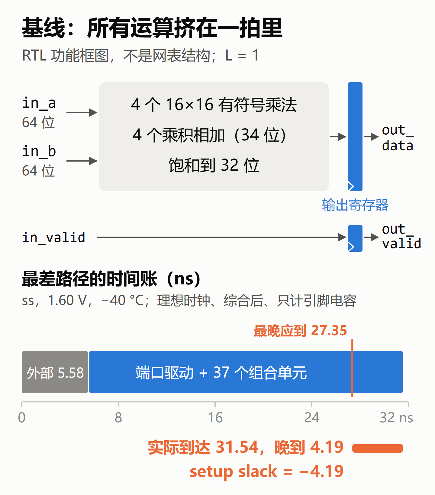

时钟周期 T = 27.91 ns。约束规定外部电路已经用掉 0.2T，也就是 5.58 ns 的输入延迟。最差的角是慢工艺、1.60 V、零下 40 度（ss_n40C_1v60）。在这个角上，最差路径从 `in_b[2]` 出发，经过端口驱动和 37 个组合单元到达输出寄存器，比最晚应到时刻晚了 4.19 ns。也就是说，基线的 setup slack 是 −4.189726 ns（理想时钟、综合后、只计引脚电容，ss_n40C_1v60）。基线面积 45383.5264 µm²。

合同给 AI 的条件：

- 延迟最多 3 拍；
- 每拍仍要接收一笔新输入；
- 接口和输入输出约束不能改；
- 面积不超过基线的 1.25 倍，即 56729.408 µm²；
- 目标是六个角的 setup slack 都 ≥ 0。

## 3. 怎么考

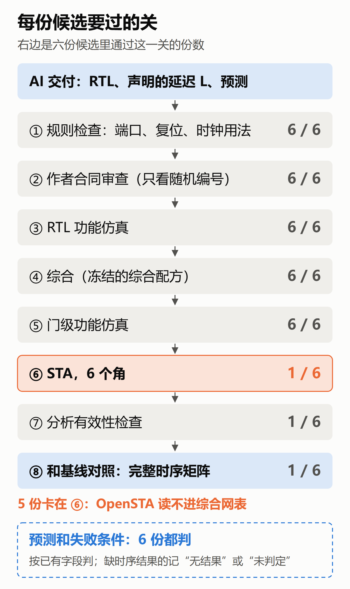

**被测对象。** Claude Opus 5.5、Kimi K3、DeepSeek V4 Pro，都通过同一版 Claude Code 命令行调用，关掉它们自己跑工具的能力，只能读材料、写答复。三家拿到同一包材料：基线 RTL、约束、时序报告、合同摘录。此外，每家还附上**它自己**在阶段 A 第 2 轮的答复。

**AI 要交什么。**

- 一份完整的 RTL；
- 它声明的延迟 L；
- 一张预测表：每行写一个指标，比如最差 setup slack 或面积，再写变化方向、范围和一个点估计；
- 失败条件：出现什么结果，就说明我的方案错了。

**复验流程**（上图）。

1. 规则检查：端口、复位、时钟用法等，由脚本自动做。
2. 作者做合同审查，比如有没有锁存器、valid 有没有复位，审查结果可以否决候选。作者看到的是随机编号，不是模型名。
3. RTL 仿真、综合、门级仿真，然后在六个角上跑 OpenSTA，最后检查分析结果本身是否有效。这一串由冻结的评分脚本 `grade.py` 完成。
4. 另一个事先写好的脚本，按冻结的规则和基线对照，判定每条预测。

**两轮。** 第 1 轮做完，只把机械的结果还给模型：哪一步失败、日志末尾几行、已经拿到的数字。不附任何诊断，也不给提示。模型据此交第 2 轮。

**开跑前封存。** 评分脚本、判定规则、反馈模板，在正式调用模型之前都提交到 git，并打上标签。编号和模型的对应表，每轮开跑前先封进一个"密封信封"：提交的只是对应表加盐后的哈希值，两轮都判完以后才公开原文，核对哈希一致。需要说明的是，这些提交都在作者自己的本地仓库里。提交的先后顺序只是作者自己的记录，不构成第三方证明。

**判分规则。** 每轮的预测和失败条件，先由操作者转写成可以机械判定的规则，再经 Codex 只读审查、作者逐条复核，在正式评估之前冻结。

## 4. 三家交了什么

6 份候选全部通过规则检查。作者合同审查全部"符合"，没有否决，也没有交付失败或放弃提交的。每份都只跑了一次正式评估，没有重试。

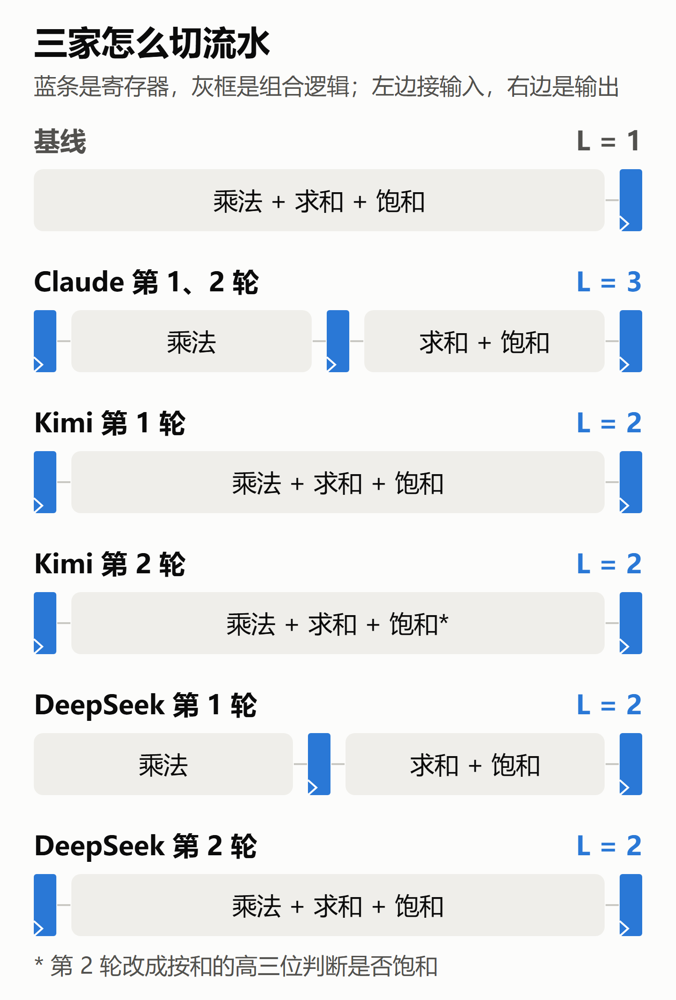

三家的方案，按各自公开答复里的说法：

- **Claude**：两轮都是 3 级流水，先把输入寄存一拍，乘积再寄存一拍，求和、饱和之后进输出寄存器，L = 3。
- **Kimi**：两轮都是把输入寄存一拍，L = 2。第 2 轮另外把饱和判断改成看和的高三位，这是它在阶段 A 提出的方案。
- **DeepSeek**：第 1 轮在乘积后面插寄存器，L = 2；第 2 轮改为输入寄存一拍，其余沿用基线写法，L = 2。

L 的意思见下图。L 表示从输入到输出经过 L 级寄存器：第 n 笔输入在上升沿 Rn 采样，结果在第 L 个寄存沿之后形成；按本实验的记号，第 n 笔输入的结果记为 O(n+L)。连续送入有效数据时，流水填满后每拍仍出一笔，吞吐不变。

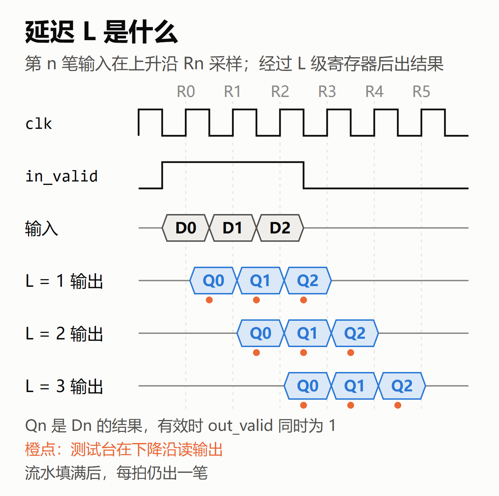

| 模型 | 轮 | L | RTL 仿真 | 门级仿真 | STA | 结果 | 面积（µm²） |
|---|---|---|---|---|---|---|---|
| Claude | 1 | 3 | 通过 | 通过 | 失败 | 评分失败 | 48790.544 |
| Claude | 2 | 3 | 通过 | 通过 | 通过 | **通过，有时序收益** | 48666.6752 |
| Kimi | 1 | 2 | 通过 | 通过 | 失败 | 评分失败 | 47983.52 |
| Kimi | 2 | 2 | 通过 | 通过 | 失败 | 评分失败 | 48169.9488 |
| DeepSeek | 1 | 2 | 通过 | 通过 | 失败 | 评分失败 | 46336.9408 |
| DeepSeek | 2 | 2 | 通过 | 通过 | 失败 | 评分失败 | 47983.52 |

表里的"评分失败"和"通过，有时序收益"，在状态文件里分别记为 `grade_fail` 和 `eligible_gain`。6 份的面积都在上限以内。

"功能仿真通过"的意思是：冻结的测试台在有限的激励下没有发现错误。每次仿真各自检查了 2816 到 2835 个点。这不是形式等价证明。测试台对输出延迟的检查也只是检查，不是延迟的证明。

## 5. 五份卡在 STA

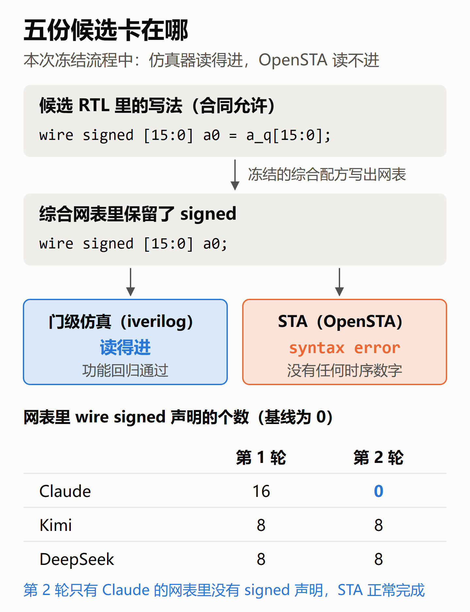

**失败在哪里。** 五份"评分失败"全部发生在 STA 这一步。OpenSTA 读综合网表时，在第一个 `wire signed [15:0] a0;` 这类声明处报 `syntax error`，后面什么都没跑。各份网表里这类声明的个数：

| | 第 1 轮 | 第 2 轮 |
|---|---|---|
| Claude | 16 | 0 |
| Kimi | 8 | 8 |
| DeepSeek | 8 | 8 |

基线网表里是 0 个。

**为什么会这样。** 候选 RTL 用 `wire signed` 声明有符号的中间信号，这是合法写法，合同也没有禁止。我们冻结的综合配方用 `write_verilog -noattr -noexpr` 写网表，会把保留下来的有符号线网照样写成 `wire signed`。同一份网表，门级仿真用的 iverilog 读得进，OpenSTA 的网表读取器读不进。

冻结流程前做校准时，用的基线和流水对照样例碰巧都没有 `signed` 声明，所以当时没有发现这个问题。这是评估流程自己的局限。基线 RTL 里其实也写了 `wire signed`，为什么网表里却是 0 个，见附录 B 第 1 问。

**少了什么结果。** STA 没有结果，这五份就没有对照矩阵，也没有任何 slack 数字。依赖时序的预测判为"无结果"，依赖时序的失败条件判为"未判定"。

**怎么写归因。** 规程只认一种"外部故障"：有证据表明是环境出了问题，比如环境快照检查失败、工具或库文件缺失、磁盘空间不足、进程被外部中断。这五份都没有这类证据，正式记录为："失败发生在 STA 步骤，未发现外部故障证据"。这**不等于"已证明是候选的错误"**。

**当时怎么处理。** 第 1 轮评估完就发现了这个问题。作者在 2026-10-25 做了裁决：

- 正式结果保留，三份第 1 轮候选仍记为评分失败；
- 第 2 轮的反馈照冻结模板发，不额外提示 `signed`；
- 网表诊断的方法先写好，等两轮全部冻结以后再跑，结果单独报告（第 9 节）。

## 6. 正式流程中唯一有效的时序分析：Claude 第 2 轮

### 6.1 插流水后，路径预算怎么变

先看结构。下面只是示意图，不按比例。

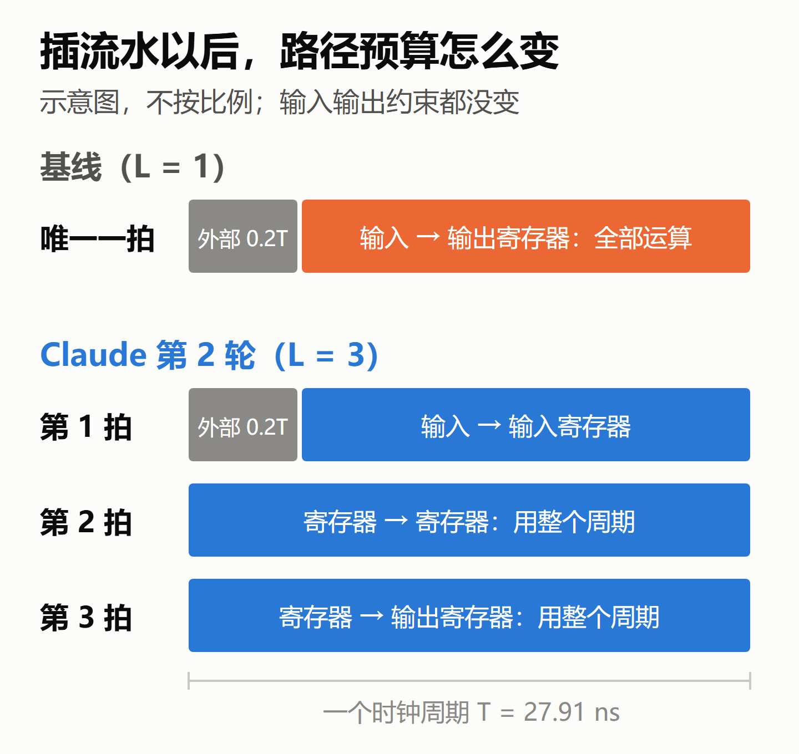

输入输出约束没变，从输入端口到第一级寄存器的路径，仍然要先扣掉 0.2T 的外部输入延迟。之后寄存器到寄存器的路径，可以用完整的一个周期。插流水以后，路径预算的分配变了。

这次没有做控制变量的对照实验，所以本文不说收益里有多少来自预算重新分配、多少来自把逻辑切开；也不把结论推到别的综合配方或物理实现上。

### 6.2 setup：六个角全部转正

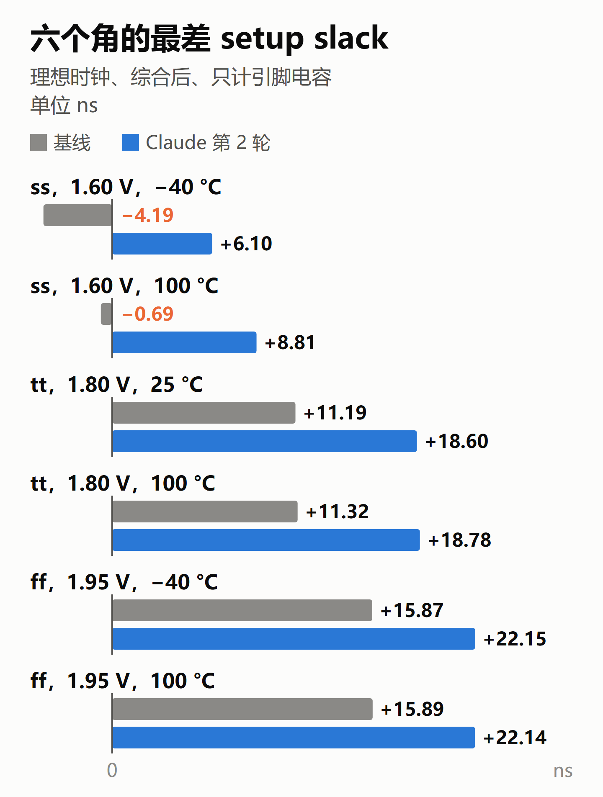

六个角里最差的 setup slack，从 −4.189726 ns 变成 +6.104896 ns（理想时钟、综合后、只计引脚电容，ss_n40C_1v60），达到了"六个角 setup 都 ≥ 0"的目标。

再看同一个角上各类路径的变化：

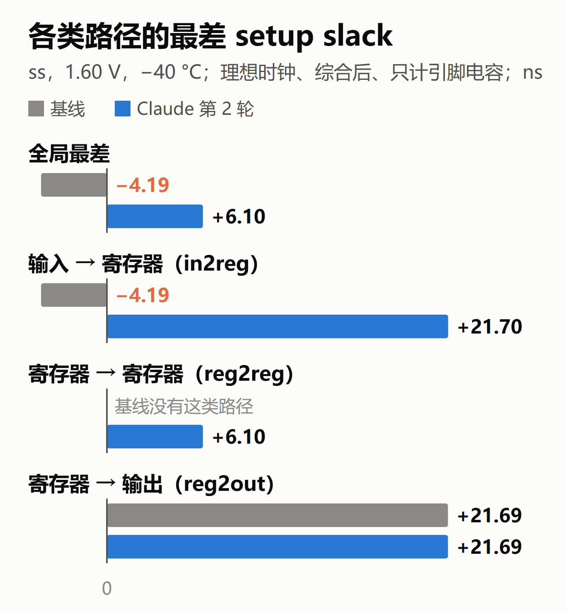

- 基线最差的是输入到寄存器的路径（`in_b[2] → _12026_/D`）。插流水后，这类路径的 slack 变成 +21.704105 ns（理想时钟、综合后、只计引脚电容，ss_n40C_1v60）。
- 新的最差路径是寄存器到寄存器（`_12500_/Q → _12338_/D`），slack 为 +6.104897 ns（理想时钟、综合后、只计引脚电容，ss_n40C_1v60）。这和基线的最差路径**不是同一条**。基线没有寄存器到寄存器的路径，这一格记为"新出现"，既不算改善，也不算退化。
- 寄存器到输出这类路径的最差 setup slack 数值没有变化，但寄存器端点已经从 `_12026_/Q` 换成了 `_12338_/Q`，不是同一条路径。

### 6.3 hold：全部变小，仍为正

hold 检查的是：采样沿之后，寄存器输入端的数据能不能再稳定足够长的时间，不被过早到达的新数据干扰这次采样。

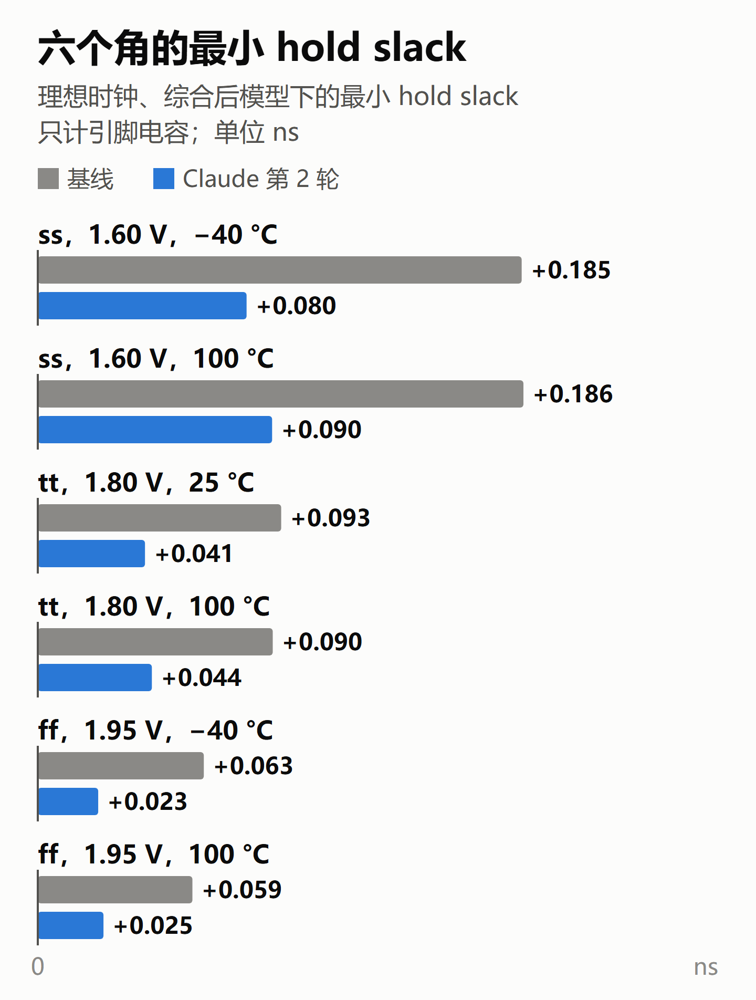

六个角的最小 hold slack（理想时钟、综合后模型下的最小 hold slack，只计引脚电容）全部比基线小，候选值仍然全部为正。逐项的差值如下，单位 ns。差值按原始精度计算后再显示，可能和表中两个已舍入的值直接相减差最后一位：

| 角 | 基线 → 候选 | 差值 |
|---|---|---|
| tt_025C_1v80 | 0.093054 → 0.040983 | −0.052071 |
| tt_100C_1v80 | 0.089830 → 0.043611 | −0.046219 |
| ss_100C_1v60 | 0.185679 → 0.089585 | −0.096094 |
| ss_n40C_1v60 | 0.185004 → 0.079827 | −0.105178 |
| ff_n40C_1v95 | 0.063473 → 0.023094 | −0.040379 |
| ff_100C_1v95 | 0.059113 → 0.025111 | −0.034002 |

所有角里最小的是 +0.023094 ns（理想时钟、综合后模型下的最小 hold slack，只计引脚电容，ff_n40C_1v95）。

### 6.4 退化项一共 13 项

对照脚本按格子计数。六个角各有"全局"和"输入到寄存器"两格 hold，共 12 格变差。每个角这两格对应的是同一条最差 hold 路径，所以 12 是格子数，不是 12 条不同的路径。ss_n40C_1v60 这个角两格的差值分别是 −0.105178 和 −0.105177，其余角两格相同。

第 13 项是面积：45383.5264 → 48666.6752 µm²，多了 3283.1488 µm²。

### 6.5 延迟和完整矩阵

延迟从 L = 1 变成 L = 3，在合同允许的上限之内，吞吐仍是每拍一笔。

六个角 × setup/hold × 四类路径，一共 48 格。完整的对照矩阵放在文末附录 A，包括每格的起点、终点、差值和是不是同一条路径。

需要强调的是，这一份的评分结果是 `GRADE OK`。它的意思是功能回归通过、分析结果有效，**不等于"优化成功"**。

## 7. 预测对不对

### 7.1 怎么判

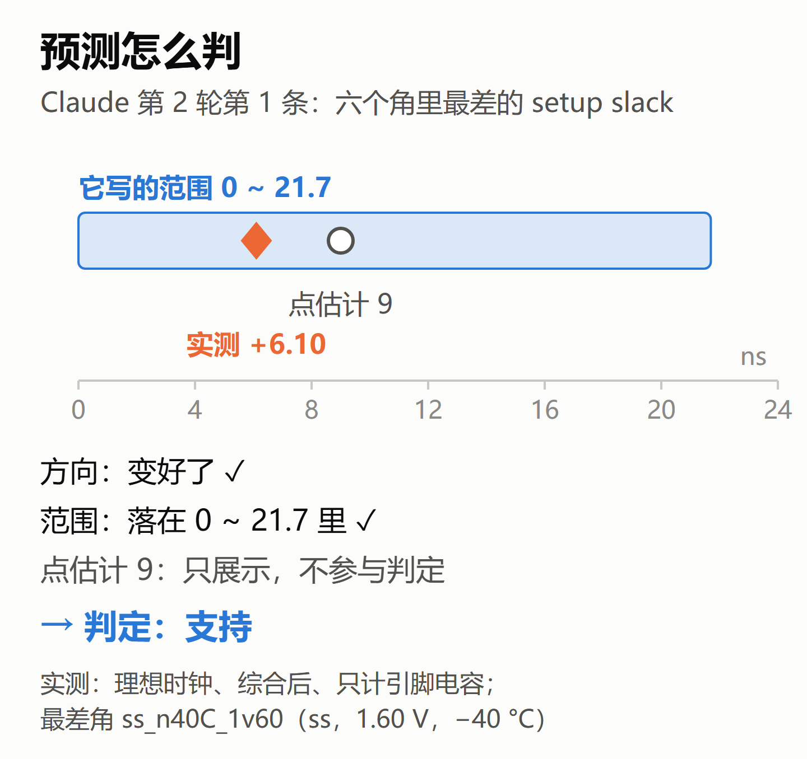

连续数值的预测：写明了方向就判方向；范围给出任何一端就判范围，没写的那一端当作无界。至少有一项能判、且能判的部分全部符合，整条判"支持"；任何一部分不符合，判"反对"；都不能判，则为"未判定"。**点估计只展示，不参与判定。** 延迟 L 和功能是离散值，直接比较。

所以，"支持"不表示点估计准确，也不表示方向和范围两项都检验过了。例如 Kimi 第 1 轮的面积预测只写了方向，没给范围；Claude 第 2 轮第 3 条只给了范围下限、方向写的是"未知"，两条都判"支持"。"反对"的意思是实测不符合预测，不表示这项结果本身变差了。

这和阶段 A 的判法不同：阶段 A 核对的是报告里已有的事实，可以按显示精度逐位检查；阶段 B 判的是事前的预测，所以不看点估计有没有命中。

再举一例： Claude 第 2 轮第 1 条预测：点估计 9 ns，实测 +6.104896 ns（理想时钟、综合后、只计引脚电容，ss_n40C_1v60），方向和范围都符合，判"支持"。

### 7.2 计数

下面这些条数受答复长短和写法影响，**不能拿来横向比较**。所有候选的"不适用""预测不一致""格式问题"都是 0。

| 模型 | 轮 | 预测条数 | 支持 | 反对 | 未判定 | 无结果 | 失败条件条数 | 触发 | 未触发 | 未判定 |
|---|---|---|---|---|---|---|---|---|---|---|
| Claude | 1 | 10 | 2 | 2 | 0 | 6 | 7 | 0 | 3 | 4 |
| Claude | 2 | 10 | 9 | 0 | 1 | 0 | 7 | 0 | 7 | 0 |
| Kimi | 1 | 7 | 3 | 0 | 0 | 4 | 5 | 0 | 3 | 2 |
| Kimi | 2 | 7 | 2 | 1 | 0 | 4 | 6 | 0 | 3 | 3 |
| DeepSeek | 1 | 5 | 3 | 0 | 0 | 2 | 4 | 0 | 1 | 3 |
| DeepSeek | 2 | 7 | 3 | 0 | 0 | 4 | 5 | 0 | 1 | 4 |

几点说明：

- 两轮一共 20 条"无结果"，全部是因为 STA 没有结果。能判的主要是延迟 L、功能和面积三类，6 份候选的 L 和功能预测全部"支持"。
- 两轮都没有任何失败条件被触发。
- Claude 第 2 轮 10 条里 9 条支持。剩下一条是最小 hold slack，模型自己把方向、范围和点估计都写成了"未知"，没法判。实测值是 +0.023094 ns（理想时钟、综合后模型下的最小 hold slack，只计引脚电容，ff_n40C_1v95），照原样列出。
- 第 2 轮 Kimi 和 DeepSeek 都写了一条失败条件："STA 再次因为网表语法或读取错误失败"。这件事确实发生了，日志里就是 syntax error。但冻结规则能用的字段区分不出 STA 失败的具体原因，判分规则冻结时，这部分就标成了"不可检验"，所以只能判"未判定"，不是"触发"。
- Kimi 第 2 轮还有一条"最差 setup slack 低于约 +0.5 ns"。"约"没有边界，判分规则冻结时整条标为不可检验。这一份候选又没有时序结果，所以只把原文和"没有数值"并列，不判对错。

## 8. 第 2 轮：模型怎么改

三家拿到的是同一种机械反馈：评分失败，失败在 STA，日志摘要里实质性的错误信息只有一条 `netlist.v line N, syntax error`；功能、面积这些数字齐全，slack 全部缺失。网表本身没有给模型。

- **Claude** 在公开答复里推断：同一份网表，门级仿真器读得进、OpenSTA 读不进，可能是新加的带 `signed` 的内部寄存器被写成了 `wire signed`。它明确写了"推断，未确认"。它保留 3 级流水不变，把 RTL 里所有 `signed` 声明删掉，改用 `$signed()` 表达式和手工符号扩展，饱和改成按位判断。它还写了一条失败条件：如果 STA 还报语法错误，就说明 `signed` 不是原因，或者不是唯一的原因。结果第 2 轮网表里没有 `signed` 声明，STA 正常完成，这条失败条件没有触发。
- **Kimi** 写明自己无法定位解析错误的原因。它保留输入寄存的结构，把饱和判断改成看高三位，想"让算术部分产生和第 1 轮明显不同的网表"，并说明"这只是规避尝试，不是已确诊的修复"。网表里仍有 8 个 `wire signed` 声明，STA 再次失败。
- **DeepSeek** 换成"结构更接近基线"的输入寄存写法，并去掉第 1 轮单独的 34 位中间赋值，想降低网表读不进的风险。网表里仍有 8 个 `wire signed` 声明，STA 再次失败。

**跨轮对照。** 第 2 轮的每条预测和失败条件，都逐条核对它和第 1 轮的对应关系，看是保留、修改还是撤回；没有对应项的记为新增，第 1 轮有、第 2 轮没提的记为"没提到"：

| 动作 | 预测 | 失败条件 |
|---|---|---|
| 保留 | 12 | 12 |
| 修改 | 9 | 3 |
| 新增 | 3 | 3 |
| 撤回 | 0 | 0 |
| 没提到 | 1 | 1 |

15 条失败条件的跨轮关联，作者在判分规则冻结之前逐条确认过。

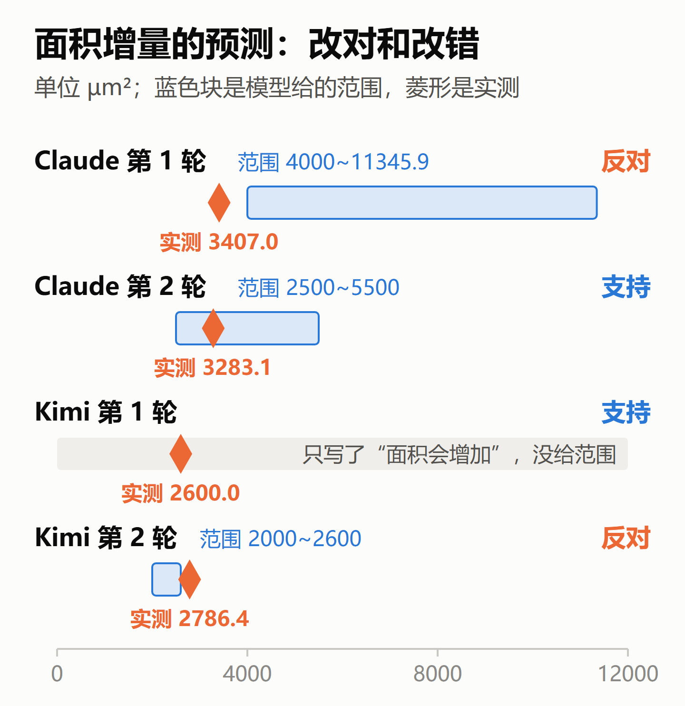

- **预测改对 2 条**，都是 Claude 的面积预测，一条是增量，一条是绝对面积。第 1 轮给的范围偏高：增量 4000–11345.9（实测 3407.0176），绝对面积 49383–56729.408（实测 48790.544），实测都低于下限，判"反对"。第 2 轮下调为增量 2500–5500（实测 3283.1488），绝对面积 47900–50900（实测 48666.6752），判"支持"。单位都是 µm²。
- **预测改错 1 条**，是 Kimi 的面积增量。第 1 轮只说"面积会增加"，方向对，判"支持"。第 2 轮给了范围 2000–2600，实测增量 2786.4224，超出上限 186.4224，判"反对"。两轮方向都对，第 2 轮说得更具体，但没有落进自己给的范围。按冻结规则，仍计为"改错"。
- **没变化或不可比 18 条**：7 条两轮都"支持"，11 条至少有一轮是"无结果"或"未判定"。这不等于这 18 条预测内容没有改动。
- **失败条件消失 0 条，仍在 0 条。** 第 1 轮本来就没有触发任何失败条件，这项统计是在一个空集上做的，不能理解成"问题全部消失了"。

## 9. 正式结果之外：网表兼容性诊断

**这是看到正式答复之后补做的诊断，不在原来的封存计划里。** 诊断方法在第 1 轮结果出来之后、任何诊断运行之前写定，经作者确认；按裁决，等两轮全部冻结以后才运行。对象是所有完成了综合的候选。

做法只有一处改动，然后照原样重放：

- **唯一的修改**：只删掉 `wire/reg signed [范围] 名字;` 这种声明行里的 `signed` 一个词，网表其余部分一个字节都不动。
- **什么情况下不做**：只接受纯单元连接的网表。如果在别的位置遇到 `signed`（端口、`$signed`、带赋值的声明），或者遇到 always/initial 块、运算表达式，就停下来，不做诊断。改完以后逐行核对：没改的行逐字节相同，单元实例数不变。6 份网表都满足这些条件。
- **重放**：照原来的运行记录，重放门级仿真、STA 和分析有效性检查。五份失败候选当初没有走到有效性检查这一步，这一步按冻结 `grade.py` 的写法补出来，标为"派生"。这个做法作者在运行前确认过。
- **对照组**：用同一流程重放基线网表，门级回归和 STA 结果与冻结的基线存档完全一致。Claude 第 2 轮的网表本来就没有 `signed`，诊断结果和正式结果完全相同。

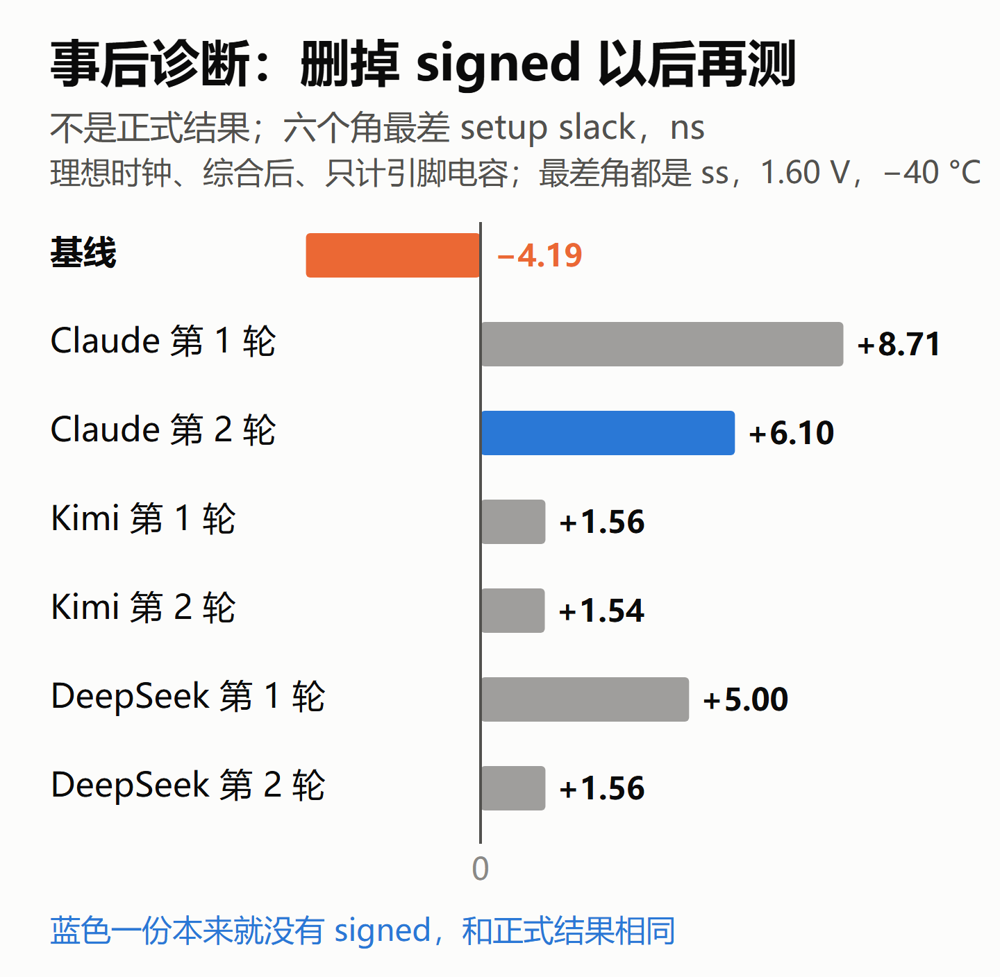

结果：6 份候选全部门级回归通过，STA 和有效性检查都通过，六个角最差 setup slack 全部 ≥ 0（理想时钟、综合后、只计引脚电容，单位 ns，最差角都是 ss_n40C_1v60）：

| 模型 | 第 1 轮 | 第 2 轮 |
|---|---|---|
| Claude | +8.708432 | +6.104896 |
| Kimi | +1.557034 | +1.542086 |
| DeepSeek | +5.004687 | +1.557034 |

**怎么理解这些数字。**

- 这些数字是对已交付候选的综合网表做了上面那处公开的修改之后，在冻结的分析模型下测出来的。
- 诊断说明存在时序改善的可能，但正式流程没能确认。
- **不能说"候选第一次交付就达到了目标"**，也不回填正式的评分结果、预测判定或跨轮统计。

另外记一个事实：DeepSeek 第 2 轮和 Kimi 第 1 轮的诊断时序、最差路径和面积完全相同，两份 RTL 文件并不相同。本文不解释两者为什么完全相同，只在附录 B 第 2 问里说明两者的流水切法一样。Claude 和 DeepSeek 第 2 轮的诊断 slack 为什么都比第 1 轮小，也见附录 B 第 2 问。

## 10. 人工修补版

没有。本阶段没有人手工修改任何候选的 RTL。第 9 节对综合网表的兼容性修改另行报告，不算人工修补版。

## 11. 人工介入和工作量

规程把人工介入分成四类。下表的统计截至 2026-10-26 揭示对应表、写全阶段汇总那一条记录，不含之后起草和审查这篇文章的工作，所以比全阶段汇总里的数字多一条。

| 类别 | 次数 | 耗时 |
|---|---|---|
| 改变模型的输入 | 6 次正式调用：每个模型每轮 1 次，第 1 轮发题，第 2 轮把机械反馈连同题目一起发；重试 0 次。另有 9 次冒烟调用，不计入正式轮次 | 计入评估工作 |
| 资格裁决 | 2 次合同审查，每次 3 个编号，没有否决 | 作者 60 分钟 |
| 人工修补版 | 0 | — |
| 评估工作 | 26 条记录 | 操作者和子代理约 1566 分钟，其中约 600 分钟是子代理（操作者调用的辅助 AI）写代码的时间；1 条规程起草阶段的记录没有逐项记时；6 条作者耗时没有记录，1 条是事后估计 |

记录里唯一一条"人工修改"，是正式开跑前作者采纳外部审查的意见、改了题目模板的措辞。这属于开跑前的题目修订，不是人工修补版。

## 12. 这次实验的短板

### 12.1 已知偏差

- **自己考自己。** 跑实验的操作者、起草本文的人，和被测的 Claude 是同一个模型，有偏向自己的风险。缓解办法：
  - 调用模型、规则检查、对照和数值判定，都由开跑前封存的脚本完成；
  - 操作者不修改任何候选；
  - 判分规则和跨轮关联在正式评估之前冻结。
- **只在作者这一侧部分盲评。** 作者做合同审查、复核规则和判定时，看到的是随机编号；但操作者知道对应关系，作者也可能从文风或阶段 A 的答复猜出是谁。这只能减少身份暗示，不能消除。
- **判分的人知道阶段 A 的情况。** 作者和操作者都看过阶段 A 的全部答复、判定标签和对照查询。题目里不写任何改法方向。
- **三家输入不完全相同。** 每个模型拿到的是自己阶段 A 的答复，这是同一个模型的纵向延续，不是严格的同输入横向比较。

### 12.2 调用方式的残留差异

阶段 B 重写了调用脚本，但沿用阶段 A 的同一个命令行副本、同一组参数和环境变量。阶段 A 记录过下面这些差异，同样的命令行和参数下预计仍然存在；**阶段 B 没有逐条重新核实**：

1. 命令行工具会在系统提示前面加一句身份声明，三家都收到了。
2. 三家收到同一段环境信息：工作目录、平台、系统版本、日期。Kimi 和 DeepSeek 的服务方也收到了材料和这些信息。
3. 只有 Claude 收到一条带账号邮箱的提醒。仓库里的答复已经脱敏。
4. 没有设置思考强度。Kimi 和 DeepSeek 的思考强度取决于服务端默认值，无法和 Claude 对齐。温度等采样参数也无法设置。
5. 调用记录里的输出上限字段，Claude 和另两家不同，但这个字段不是实际生效的上限。阶段 B 冒烟时把上限临时设成 64 token，三家都被截断，说明这个设置对三家都生效。
6. Kimi 和 DeepSeek 经过一层兼容接口。

### 12.3 看到答复以后改过的地方

- **评估流程的 STA 局限**：按"保留正式结果、两轮冻结后另做诊断"处理，冻结的文件一个都没改（第 5、9 节）。
- **判分规则**：第 1 轮审查后，改了两条门槛类失败条件的写法；第 2 轮审查后，把 Kimi"低于约 +0.5 ns"那条改成不可检验。都发生在规则冻结之前，经作者复核。
- **判定说明**：第 2 轮"未判定"的说明按审查意见改写了 6 条，判定结果不变。第 1 轮有 6 条说明把缺失的时序字段写成了"不适用"，准确的说法应该是"STA 没有结果，所需字段缺失"。判定不受影响，冻结文件不改，更正记在全阶段汇总里。
- **网表诊断**：补出有效性检查一步，标为"派生"（第 9 节）。

## 13. 这些结论在什么条件下成立

- 分析在布局之前做，时钟按理想情况处理；只计引脚电容，没有连线寄生；输入驱动的 transition 取 0 ns。这些都是简化。
- 综合配方没有设置时钟目标和输入输出目标，也没有物理修复步骤。用的是这个案例专用的 ABC 优化序列，没有执行显式的 `&fraig` 和 `scorr`。
- 没有证明这些 RTL 修改在 Yosys 默认配方或其他综合流程下仍然有效。如果某个修改主要靠消除冗余取得收益，默认流程可能自己就能消掉同样的冗余，也可能得到不同的映射。这次没有做配对对照，不能断言默认流程一定能、或者一定不能取得同样的收益。结果只说明这个 RTL 修改在已冻结配方下的效果，不说明 AI 超过了默认综合器的优化能力。
- 所有结论只在这个固定的分析模型、这六个检查过的角之内成立，不能推到流片后的芯片频率或布线后的时序收敛。

## 14. 下次怎么做

- **评估流程要先用"刁钻"的输入校准。** 校准用的样例碰巧都没有 `signed` 声明，结果一个合法写法就让五份候选拿不到任何时序数字。下次冻结之前，要用更多样的网表写法测一遍 STA 能不能读进来，比如有符号线网、不同的综合输出形式。
- **题目模板。** 失败条件里的数值边界要写成精确值，不接受"约"。这是作者在第 2 轮复核判分规则时提出的，留给后面的案例。
- **拿到机械反馈以后怎么应对。** 第 2 轮的反馈里有：失败位置、一条语法错误日志、功能回归结果和检查点数、L、面积和是否超上限、缺失的时序字段。题目里还附了第 1 轮的完整题目和模型自己上一轮的答复。拿到同样的反馈，三家给出了不同的应对。只有 Claude 在公开答复里明确提出了 `signed` 兼容性的假设，后来的诊断结果和这个假设一致。但这次没有改变反馈内容来做对照，判断不了反馈信息量的作用；而且只有一次观察，推不出一般规律。

---

## 数字出处

文中路径都相对于仓库的 `tasks/CASE-01/`。阶段 B 的规程是 `revise/protocol.md` v0.5，全阶段汇总是 `revise/compare/summary.md`。

| 内容 | 出处 |
|---|---|
| 基线时序、面积，周期和约束 | `evidence/F1/`；`spec.md`；时间账同文章 1 |
| 合同条件（L 上限、面积上限、时序目标） | `spec.md`；`revise/protocol.md` |
| 规则检查、合同审查、两轮流程、开跑前封存 | `revise/protocol.md` §3、§5、§7、§11；`revise/scripts/gate.py` |
| 预测怎么判、收益的结构性说明、人工修补版、介入四类 | `revise/protocol.md` §10.2、§12.4、§7.4、§13 |
| 编号与模型的对应 | `revise/outputs/mapping_r1.json`、`mapping_r2.json` |
| 每份候选的状态、面积、检查点数 | `revise/results/r<轮>/<编号>/status.json` |
| 候选 RTL、公开答复 | `rtl/dot4sat_<编号>.v`、`revise/outputs/r<轮>/<编号>.md` |
| STA 失败日志 | 例如 `revise/results/r2/cand_c1dx/attempt1/sta/sta.log` |
| `signed` 声明个数、网表诊断 | `revise/notes/netlist_diagnosis_plan.md`、`netlist_diagnosis_results.md` |
| 裁决 D-01 | `revise/notes/decisions.md` |
| Claude 第 2 轮对照矩阵、退化项 | `revise/compare/r2_cand_u2pe.md`（由 `revise/scripts/compare.py` 生成） |
| 预测和失败条件判定、说明 | `revise/predictions/r<轮>_judgments.md`、`r<轮>_notes.jsonl` |
| 跨轮对照 | `revise/predictions/r2_coverage_result.json` |
| 人工介入分类 | `revise/compare/summary.md` §6（介入记录本身只在本机） |
| 调用方式的残留差异 | `diag/protocol.md` §5.1；`revise/protocol.md` §6.1 |
| 第 2 轮反馈 | `revise/prompts/r2/*_feedback.md` |
| 本文图表 | 仓库根目录下 `docs/posts/figs/article2/make_figs.js` |

## 附录 A：Claude 第 2 轮完整对照矩阵

理想时钟、综合后、只计引脚电容；slack 和差值单位 ns；hold 为理想时钟、综合后模型下的最小 hold slack。基线是冻结的基线存档。"introduced"表示基线没有这类路径、候选新出现，不算改善也不算退化；"同一路径"指起点和终点都相同。原样摘自 `revise/compare/r2_cand_u2pe.md`。

| corner | 检查 | 范围 | 基线 slack | 基线起点 → 终点 | 候选 slack | 候选起点 → 终点 | 差值 | 变化 | 同一路径 |
|---|---|---|---|---|---|---|---|---|---|
| ff_100C_1v95 | setup | global | 15.894229 | in_b[2] → _12026_/D | 22.143077 | _12338_/Q → out_data[0] | 6.248849 | better | 否 |
| ff_100C_1v95 | setup | in2reg | 15.894229 | in_b[2] → _12026_/D | 22.194113 | in_valid → _12337_/D | 6.299884 | better | 否 |
| ff_100C_1v95 | setup | reg2reg | not_applicable | not_applicable → not_applicable | 22.560680 | _12500_/Q → _12338_/D | not_applicable | introduced | 否 |
| ff_100C_1v95 | setup | reg2out | 22.143078 | _12026_/Q → out_data[0] | 22.143078 | _12338_/Q → out_data[0] | 0.000000 | same | 否 |
| ff_100C_1v95 | hold | global | 0.059113 | rst → _12058_/D | 0.025111 | in_a[0] → _12371_/D | -0.034002 | worse | 否 |
| ff_100C_1v95 | hold | in2reg | 0.059113 | rst → _12058_/D | 0.025111 | in_a[0] → _12371_/D | -0.034002 | worse | 否 |
| ff_100C_1v95 | hold | reg2reg | not_applicable | not_applicable → not_applicable | 0.262414 | _12337_/Q → _12336_/D | not_applicable | introduced | 否 |
| ff_100C_1v95 | hold | reg2out | 0.179844 | _12026_/Q → out_data[0] | 0.179844 | _12338_/Q → out_data[0] | 0.000000 | same | 否 |
| ff_n40C_1v95 | setup | global | 15.871505 | in_b[2] → _12026_/D | 22.154275 | _12338_/Q → out_data[0] | 6.282770 | better | 否 |
| ff_n40C_1v95 | setup | in2reg | 15.871506 | in_b[2] → _12026_/D | 22.185606 | in_valid → _12337_/D | 6.314100 | better | 否 |
| ff_n40C_1v95 | setup | reg2reg | not_applicable | not_applicable → not_applicable | 22.522612 | _12500_/Q → _12338_/D | not_applicable | introduced | 否 |
| ff_n40C_1v95 | setup | reg2out | 22.154276 | _12026_/Q → out_data[0] | 22.154276 | _12338_/Q → out_data[0] | 0.000000 | same | 否 |
| ff_n40C_1v95 | hold | global | 0.063473 | rst → _12058_/D | 0.023094 | in_a[0] → _12371_/D | -0.040379 | worse | 否 |
| ff_n40C_1v95 | hold | in2reg | 0.063473 | rst → _12058_/D | 0.023094 | in_a[0] → _12371_/D | -0.040379 | worse | 否 |
| ff_n40C_1v95 | hold | reg2reg | not_applicable | not_applicable → not_applicable | 0.253710 | _12337_/Q → _12336_/D | not_applicable | introduced | 否 |
| ff_n40C_1v95 | hold | reg2out | 0.173251 | _12026_/Q → out_data[0] | 0.173251 | _12338_/Q → out_data[0] | 0.000000 | same | 否 |
| ss_100C_1v60 | setup | global | -0.687278 | in_b[35] → _12026_/D | 8.810737 | _12500_/Q → _12338_/D | 9.498015 | better | 否 |
| ss_100C_1v60 | setup | in2reg | -0.687278 | in_b[35] → _12026_/D | 21.802567 | in_valid → _12337_/D | 22.489845 | better | 否 |
| ss_100C_1v60 | setup | reg2reg | not_applicable | not_applicable → not_applicable | 8.810738 | _12500_/Q → _12338_/D | not_applicable | introduced | 否 |
| ss_100C_1v60 | setup | reg2out | 21.742086 | _12026_/Q → out_data[0] | 21.742086 | _12338_/Q → out_data[0] | 0.000000 | same | 否 |
| ss_100C_1v60 | hold | global | 0.185679 | rst → _12058_/D | 0.089585 | in_a[0] → _12371_/D | -0.096094 | worse | 否 |
| ss_100C_1v60 | hold | in2reg | 0.185679 | rst → _12058_/D | 0.089585 | in_a[0] → _12371_/D | -0.096094 | worse | 否 |
| ss_100C_1v60 | hold | reg2reg | not_applicable | not_applicable → not_applicable | 0.845048 | _12337_/Q → _12336_/D | not_applicable | introduced | 否 |
| ss_100C_1v60 | hold | reg2out | 0.538051 | _12026_/Q → out_data[0] | 0.538051 | _12338_/Q → out_data[0] | 0.000000 | same | 否 |
| ss_n40C_1v60 | setup | global | -4.189726 | in_b[2] → _12026_/D | 6.104896 | _12500_/Q → _12338_/D | 10.294622 | better | 否 |
| ss_n40C_1v60 | setup | in2reg | -4.189726 | in_b[2] → _12026_/D | 21.704105 | in_valid → _12337_/D | 25.893831 | better | 否 |
| ss_n40C_1v60 | setup | reg2reg | not_applicable | not_applicable → not_applicable | 6.104897 | _12500_/Q → _12338_/D | not_applicable | introduced | 否 |
| ss_n40C_1v60 | setup | reg2out | 21.692432 | _12026_/Q → out_data[0] | 21.692432 | _12338_/Q → out_data[0] | 0.000000 | same | 否 |
| ss_n40C_1v60 | hold | global | 0.185004 | rst → _12058_/D | 0.079827 | in_a[0] → _12371_/D | -0.105178 | worse | 否 |
| ss_n40C_1v60 | hold | in2reg | 0.185004 | rst → _12058_/D | 0.079827 | in_a[0] → _12371_/D | -0.105177 | worse | 否 |
| ss_n40C_1v60 | hold | reg2reg | not_applicable | not_applicable → not_applicable | 0.901372 | _12337_/Q → _12336_/D | not_applicable | introduced | 否 |
| ss_n40C_1v60 | hold | reg2out | 0.548442 | _12026_/Q → out_data[0] | 0.548442 | _12338_/Q → out_data[0] | 0.000000 | same | 否 |
| tt_025C_1v80 | setup | global | 11.185458 | in_b[35] → _12026_/D | 18.599773 | _12500_/Q → _12338_/D | 7.414315 | better | 否 |
| tt_025C_1v80 | setup | in2reg | 11.185458 | in_b[35] → _12026_/D | 22.099394 | in_valid → _12337_/D | 10.913936 | better | 否 |
| tt_025C_1v80 | setup | reg2reg | not_applicable | not_applicable → not_applicable | 18.599773 | _12500_/Q → _12338_/D | not_applicable | introduced | 否 |
| tt_025C_1v80 | setup | reg2out | 22.047794 | _12026_/Q → out_data[0] | 22.047794 | _12338_/Q → out_data[0] | 0.000000 | same | 否 |
| tt_025C_1v80 | hold | global | 0.093054 | rst → _12058_/D | 0.040983 | in_a[0] → _12371_/D | -0.052071 | worse | 否 |
| tt_025C_1v80 | hold | in2reg | 0.093054 | rst → _12058_/D | 0.040983 | in_a[0] → _12371_/D | -0.052071 | worse | 否 |
| tt_025C_1v80 | hold | reg2reg | not_applicable | not_applicable → not_applicable | 0.413808 | _12337_/Q → _12336_/D | not_applicable | introduced | 否 |
| tt_025C_1v80 | hold | reg2out | 0.272520 | _12026_/Q → out_data[0] | 0.272520 | _12338_/Q → out_data[0] | 0.000000 | same | 否 |
| tt_100C_1v80 | setup | global | 11.317221 | in_b[35] → _12026_/D | 18.778149 | _12500_/Q → _12338_/D | 7.460928 | better | 否 |
| tt_100C_1v80 | setup | in2reg | 11.317222 | in_b[35] → _12026_/D | 22.108919 | in_valid → _12337_/D | 10.791697 | better | 否 |
| tt_100C_1v80 | setup | reg2reg | not_applicable | not_applicable → not_applicable | 18.778149 | _12500_/Q → _12338_/D | not_applicable | introduced | 否 |
| tt_100C_1v80 | setup | reg2out | 22.045441 | _12026_/Q → out_data[0] | 22.045441 | _12338_/Q → out_data[0] | 0.000000 | same | 否 |
| tt_100C_1v80 | hold | global | 0.089830 | rst → _12058_/D | 0.043611 | in_a[0] → _12371_/D | -0.046219 | worse | 否 |
| tt_100C_1v80 | hold | in2reg | 0.089830 | rst → _12058_/D | 0.043611 | in_a[0] → _12371_/D | -0.046219 | worse | 否 |
| tt_100C_1v80 | hold | reg2reg | not_applicable | not_applicable → not_applicable | 0.416498 | _12337_/Q → _12336_/D | not_applicable | introduced | 否 |
| tt_100C_1v80 | hold | reg2out | 0.278449 | _12026_/Q → out_data[0] | 0.278449 | _12338_/Q → out_data[0] | 0.000000 | same | 否 |

## 附录 B：作者定稿后的两个追问

作者定稿后又问了两个问题。下面是操作者查了网表和诊断运行的路径报告之后的回答，由作者决定放进文章。这两段都是事后分析，不在封存计划里，不改变任何正式结果或判定；涉及的 slack 都是第 9 节的诊断数据，不是正式结果；本附录所有 slack 和到达时间都是理想时钟、综合后、只计引脚电容条件下 ss_n40C_1v60 这个角的值。所用文件都在 git 忽略的运行目录 `tasks/CASE-01/runs/` 下，没有随仓库公开。

### 第 1 问：基线 RTL 里也有 `wire signed`，为什么基线网表里是 0 个？

基线 RTL 里确实也写了 `wire signed [15:0] a0 = in_a[15:0];`。差别在于 `a0` 这个名字最后挂在了什么东西上：

- **基线**：`a0` 只是输入端口 `in_a` 的一段别名。综合后，网表保留的是端口名 `in_a`，`a0` 被合并掉了，网表里找不到 `a0` 这个名字。`p0`、`sum` 这些中间结果也被拆进了门级单元之间的内部连线，名字同样没有留下。所以基线网表里一个 `signed` 声明都没有。
- **候选**，以 DeepSeek 第 2 轮为例：`a0 = a_q[15:0];`，`a_q` 是新加的输入寄存器，`a0` 是它输出端的别名。综合后，寄存器输出这根线用了 `a0` 这个名字，网表里写的是 `.Q(a0[0])`，`a_q` 反而找不到了。`a0` 带着 `signed` 属性留了下来，于是写成了 `wire signed [15:0] a0;`。

打个比方：在这两份网表里，别名贴在端口上会被撕掉，贴在寄存器输出上就留了下来。校准用的样例碰巧没有出现第二种情况。

这个结论来自两份网表的直接比对，属于观察到的现象；没有查综合工具的源码，去确认它选名字的规则。

出处：基线网表 `runs/20261009-092827-base-T27.91/synth/netlist.v`；候选网表的改动记录 `runs/revise-diag-netlist/r2_cand_c1dx_attempt1/netlist.diff`，以及同目录的 `netlist.v`。

### 第 2 问：为什么 Claude 和 DeepSeek 第 2 轮的诊断 slack 都比第 1 轮小？

两家报告里呈现的变化不一样。

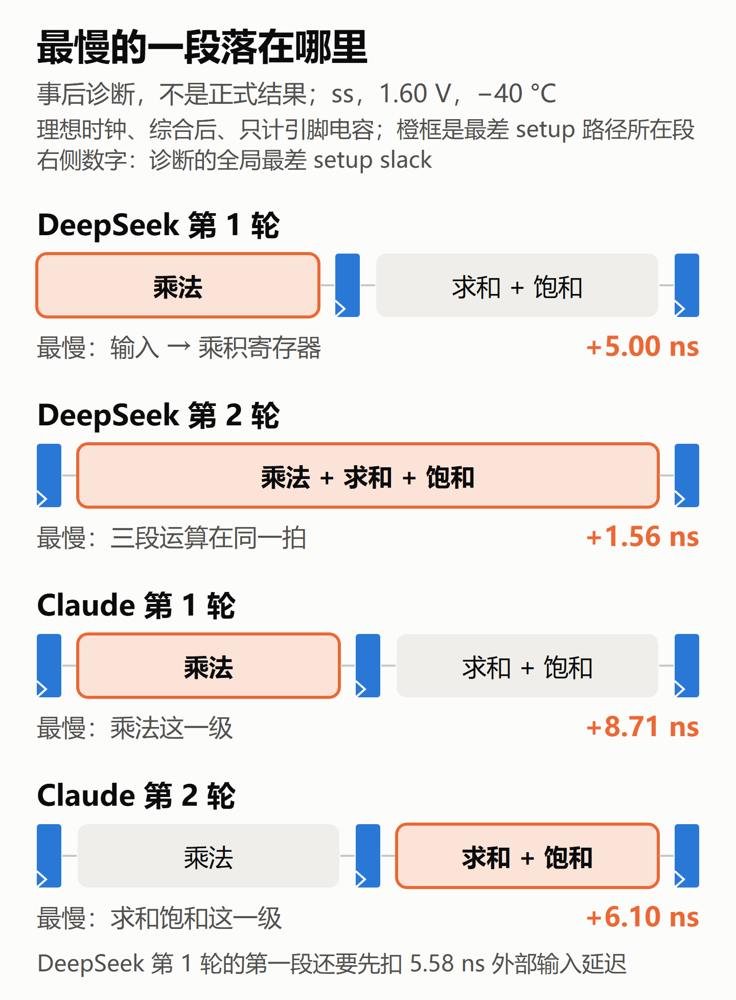

**DeepSeek：第 2 轮换了切点，三段运算挤进了一拍。**

| | 切法 | 最差 setup 路径 | 经过单元数 | 诊断的全局最差 setup slack（ns） |
|---|---|---|---|---|
| 第 1 轮 | 乘法之后插寄存器 | 输入 `in_b[17]` → 乘法 → 乘积寄存器 `p1_q` | 33 | +5.004687 |
| 第 2 轮 | 只在输入端插寄存器 | 输入寄存器 `a2` → 乘法 + 求和 + 饱和 → `out_data[12]` | 38 | +1.557034 |

slack 均为理想时钟、综合后、只计引脚电容，ss_n40C_1v60。

- 第 1 轮最慢的是第一段：从输入端口经乘法到乘积寄存器。这一段要先扣掉 5.58 ns 的外部输入延迟，但只有乘法一种运算。后半段（乘积 → 求和、饱和 → 输出）的诊断 slack 是 +7.942061 ns。
- 第 2 轮把寄存器挪到了乘法前面，乘法、求和、饱和全部落在同一拍里。这一拍虽然能用完整的周期，但逻辑更长，诊断 slack 只剩 +1.557034 ns。
- 这和 Kimi 第 1 轮的切法相同，两份的诊断数字也完全相同（第 9 节）。

**Claude：两轮切法相同，第 2 轮最差路径换到了第 3 级。**

两轮都是 3 级：输入寄存 → 乘法 → 乘积寄存 → 求和 + 饱和 → 输出寄存。

| | 最差路径在哪一级 | 最差 setup 路径 | 经过单元数 | 数据到达时间（ns） | 诊断的全局最差 setup slack（ns） |
|---|---|---|---|---|---|
| 第 1 轮 | 第 2 级（乘法） | 输入寄存器 `a2[1]` → 乘积寄存器 `p2_r[31]` | 32 | 18.8138 | +8.708432 |
| 第 2 轮 | 第 3 级（求和 + 饱和） | 乘积寄存器 → `out_data[0]` | 32 | 21.3492 | +6.104896 |

slack 和到达时间均为理想时钟、综合后、只计引脚电容，ss_n40C_1v60。

- 第 1 轮最慢的是乘法那一级。它的第 3 级不会低于全局最差值 +8.71 ns，否则最差路径就会落在第 3 级。
- 第 2 轮最慢的变成了第 3 级，只有 +6.10 ns。所以第 3 级的最差 setup slack 至少比第 1 轮减少约 2.6 ns。这是 slack 的差，slack 里还包含捕获寄存器的 setup 要求，不能直接当成组合逻辑多花的时间。
- 第 2 轮也改写了第 3 级的 RTL：为了去掉 `signed`，有符号求和改成手工符号扩展（例如 `e0 = {{2{p0_r[31]}}, p0_r}`）；和常数比较的饱和判断，改成根据和的第 33 位（符号位）以及第 32、31 位来判断。电路功能没变。
- 这次没有做控制变量实验，不能确定这些改写各自对时序变化起了多大作用，也不分析进位链或综合映射的细节。能确定的只是：同样的切法，第 2 轮的 RTL 写法不同，最慢的那一级从乘法级换成了求和饱和级。

第 2 轮表中"乘积寄存器"的输出在网表里叫 `e0[1]`，原因同第 1 问：寄存器输出用了别名 `e0` 的名字。

出处：六位小数的 slack 取自 `runs/revise-diag-netlist/<对象>/sta/sta_results.tsv`（与同目录 `result.json` 一致）；路径、经过单元数和到达时间取自 `sta/cat_ss_n40C_1v60_in2reg_max.rpt`、`cat_ss_n40C_1v60_reg2reg_max.rpt`；寄存器名按同目录 `netlist.v` 中的 `.Q` 连线对照；RTL 见 `rtl/dot4sat_cand_wpml.v`、`dot4sat_cand_c1dx.v`、`dot4sat_cand_9pbi.v`、`dot4sat_cand_u2pe.v`。
