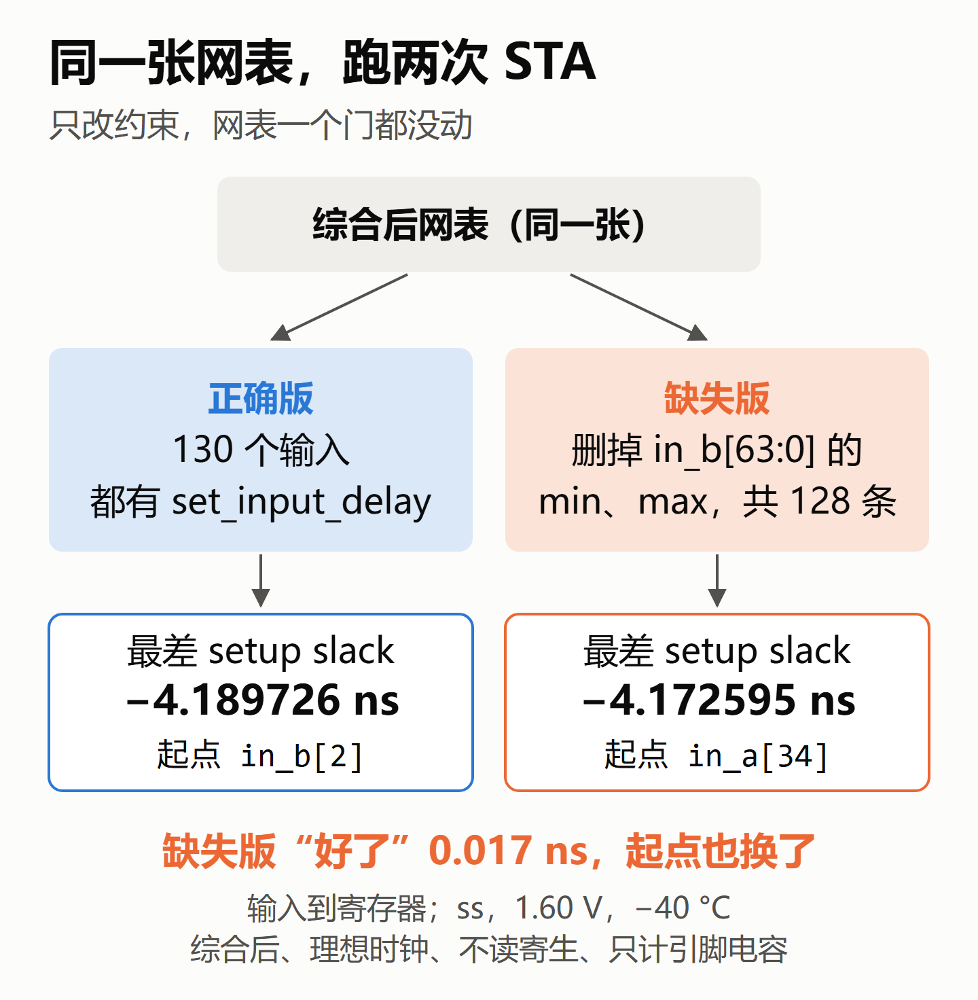
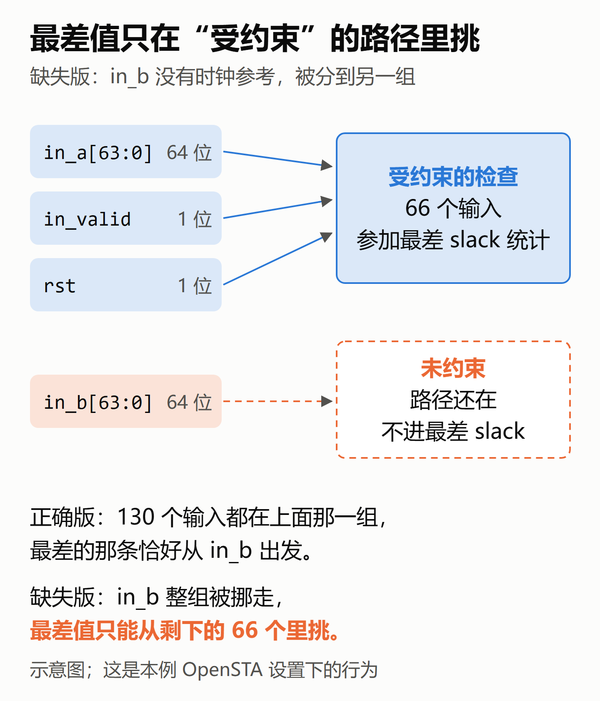
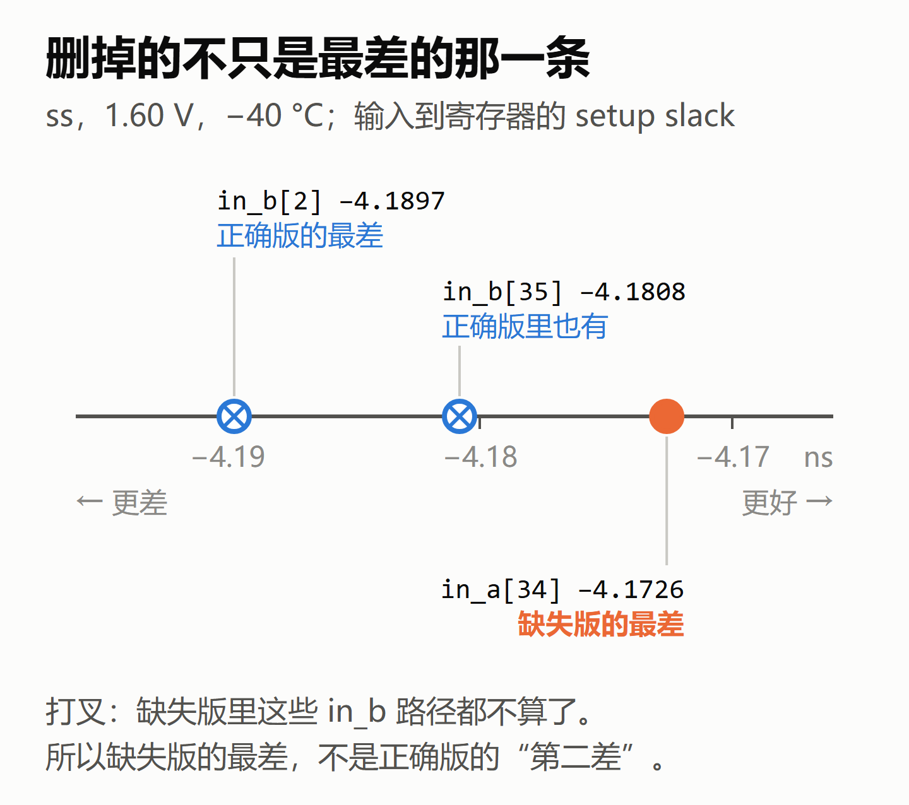
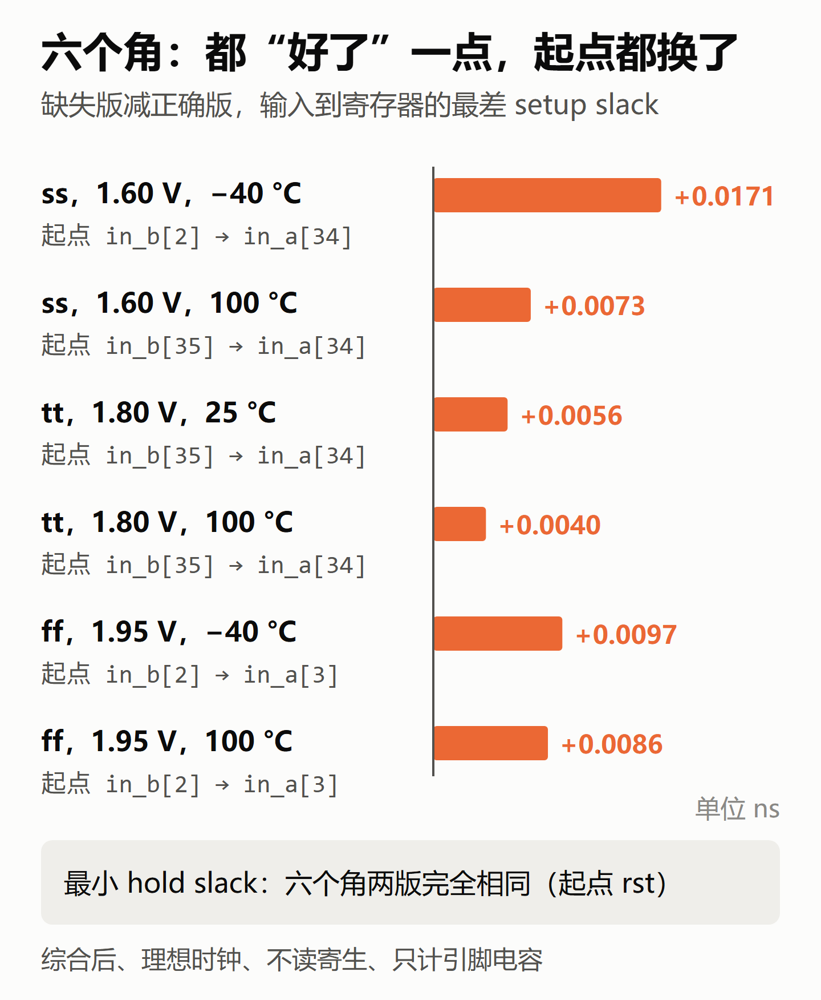
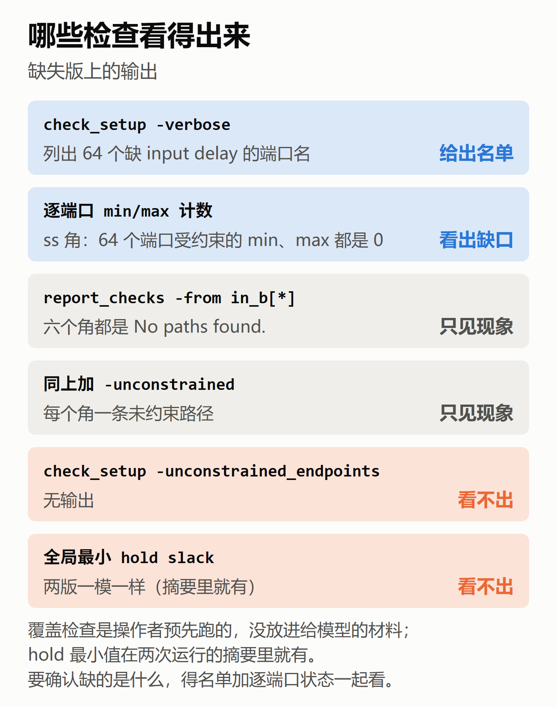
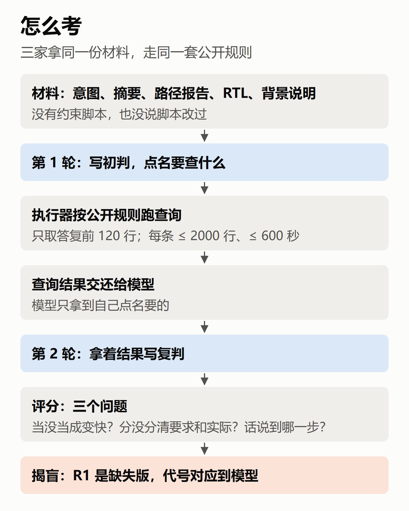
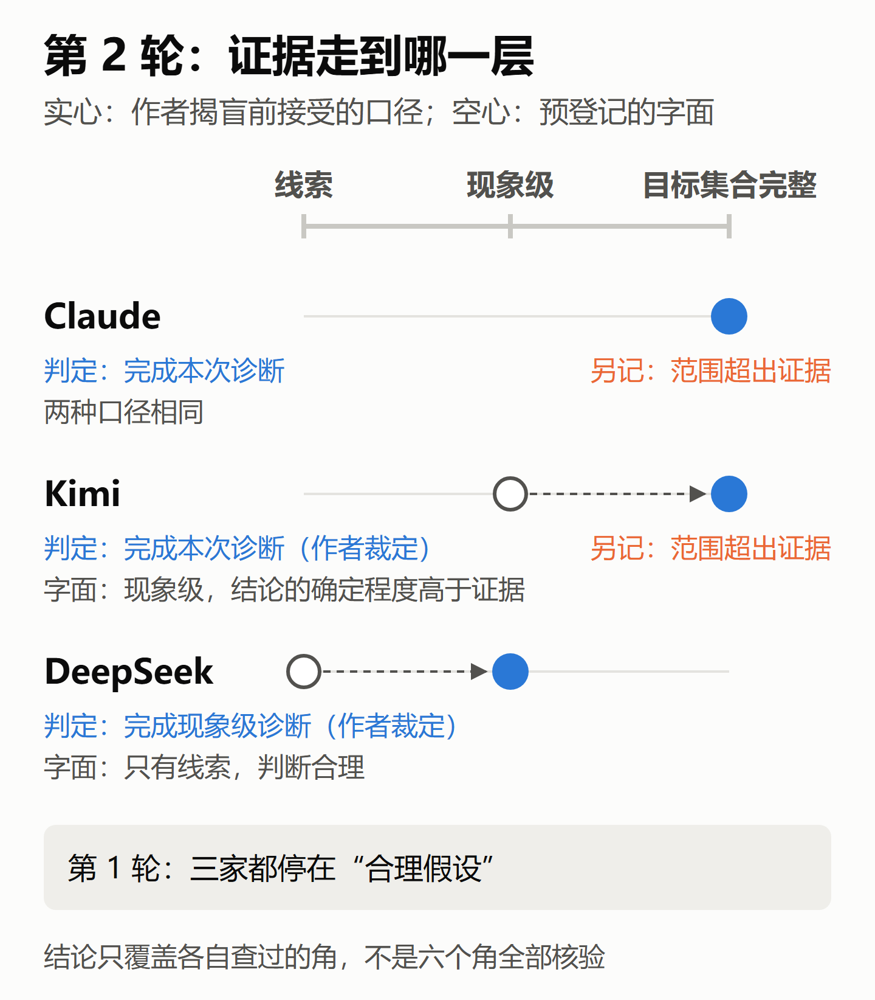

# 约束漏了 128 条，slack 反而变好：Claude Opus 5.5、DeepSeek V4 Pro、Kimi K3 怎么查出来

> AI 提出的时序建议，用工程实验验证 · CASE-02
>
> 公众号版。文中的数字都来自完整版，那里每个数字都标了出处。本文由项目里负责跑实验的 Claude 起草（和被测的 Claude 是同一个模型），作者修改定稿。
>
> 本文所有 slack 都出自同一个分析模型：综合后网表、理想时钟、不读寄生、只计引脚电容，每个数字都注明是哪个角。

## 1. 一个"变好"的指标

做过回归的人都遇到过：某天跑出来，一个指标突然变好了。新手会高兴，觉得设计变快了。老手会先去查这次回归的 checker 是不是少挂了几个。

这一篇就是给三个大模型出这道题。

同一张综合后的网表，跑了两次静态时序分析。其中一次，按我确认过的方案，故意把 `in_b[63:0]` 这 64 个输入的 `set_input_delay` 删掉了，min 和 max 各一条，一共 128 条。结果"输入到寄存器"的最差 setup slack 反而好了一点：六个角上好了 0.0040 到 0.0171 ns，最差路径的起点也从 `in_b` 换成了 `in_a`。

三个模型拿到同样的材料，先写初判，点名要查什么。执行器按公开的规则跑它们点名的查询，把输出交还，它们再写复判。跑实验、设计这个病灶的，是项目里负责操作的 Claude；我确认方案、做裁定、复核和定稿。

先说结果：

- 第 1 轮，三家都没有把 slack 变好说成电路变快，都怀疑是约束覆盖出了问题，也都只说到"假设"为止。
- 第 2 轮，Claude 和 Kimi 都确认 R1 里 `in_b` 全部 64 位的 min 和 max 都缺。Kimi 这一条，靠的是我在揭盲前做的一次口径放宽。
- DeepSeek 有一条查询用了 OpenSTA 没有的选项，每组报错 780 次。但它的结论只写到有 64 个端口没进检查，没有往前多说。
- Claude 和 Kimi 各多说了一句证据撑不住的话。

这次材料里线索很明显，测的不是"能不能凭空找到病灶"，而是拿到证据以后怎么用、话说到哪一步。每家每轮只跑了一次，推不出谁更强，本文也不排名。

上一篇结尾我说，这一篇要看 AI 能不能分清"真的变快"和"约束漏了"。实际只做到一半：这次只有"约束漏了"这一种情况，没有"真的变快"的对照组，所以测不出"分清"的能力。

## 2. 为什么漏了约束，slack 反而变好

`set_input_delay` 告诉 STA：外部信号相对这个时钟沿，几点几分才到端口。在这次的 OpenSTA 设置下，有了它，从这个端口出发的路径才参与受约束的检查、算出 slack。

删掉以后，`in_b` 的 64 个端口没有任何时钟参考。路径还在，但 STA 把它们归到"未约束"一组，不参与最差 slack 的统计。最差值只能在剩下的 66 个输入里挑。正确的那次，最差路径恰好从 `in_b` 出发；删掉以后，最差值改由剩下的一条 `in_a` 路径决定，数值好一点点。

最差的角是慢工艺、1.60 V、零下 40 度（ss_n40C_1v60）：

| | 最差 setup slack | 起点 |
|---|---|---|
| 正确的约束 | −4.189726 ns | in_b[2] |
| 漏掉 in_b 的约束 | −4.172595 ns | in_a[34] |

（综合后、理想时钟、不读寄生、只计引脚电容，ss_n40C_1v60。）

这个角上，正确版里排在 `in_b[2]` 后面的还有一条从 `in_b[35]` 出发的路径（−4.1808 ns），删掉约束以后也一起不算了。所以缺失版的最差，不是正确版的"第二差"。

注意两点。第一，"变好"以后照样是负的，电路一点没变快，只是少查了 64 个端口。第二，差别只有 0.017 ns，只看数字很容易当成噪声。真正露馅的是起点换了。

还有一个坑。很多人习惯用 `check_setup -unconstrained_endpoints` 查有没有漏约束，这次它什么都没报。原因是这 64 个端口到达的寄存器，还有别的受约束输入也能到达，终点本身仍然受约束。能直接看出问题的是 `check_setup -verbose`：它会说"64 个输入端口缺 set_input_delay"，并列出 64 个名字。

hold 也一样。删掉的 128 条里有 64 条是 min delay，`in_b` 的 hold 检查也跟着没了。但全局最小 hold slack 两次一模一样，因为最差的 hold 路径从 `rst` 出发，和 `in_b` 无关。只看全局最差值，同样看不出 hold 覆盖少了一块。

操作者预先跑的这些覆盖检查，没有放进给模型的材料；全局 hold 最小值例外，它在两次运行的摘要里就有。模型后来只能拿到自己点名查询所生成的结果。

## 3. 怎么考

三家拿到的材料完全一样：接口意图、两次运行的摘要、两份最差路径报告、RTL，还有一份背景说明。接口意图写了全部 130 个输入应该加什么约束。背景说明里明写了一句：两次运行实际生效的约束清单还没提供，可以在检查请求里要。

材料里没有约束脚本，也没说脚本改过。两次运行只叫 R1 和 R2。揭盲以后才知道 R1 是漏约束的那次。

上一篇吃过一个亏：流程里有一条模型不知道的规则，替模型决定了结果。这次就把查询怎么执行写进背景说明，三家看到的是同一份：每个查询最多交还 2000 行，最多跑 600 秒，每家最多 12 条请求，交还结果总共不超过 600000 token。抽取查询只看答复的前 120 行，Claude 确有一条窗口外的请求没有执行。已执行的查询都没有被截断、超时，也没有碰到总预算。

评分不问猜没猜对，只问三件事：有没有把 slack 变好当成电路变快；有没有分清"接口要求加什么"和"这次实际加了什么"；结论说到哪一步，和手里的证据对不对得上。

判据、判例、执行规则都在有效的第 1 轮之前提交、打标签，有一处例外见第 7 节。运行时只用随机代号，对应表封存到揭盲。三家走同一版命令行外壳，工具全部关掉，只能读材料、写答复。外壳相同不等于底层条件全对齐：思考强度等参数对不齐，Kimi 和 DeepSeek 还要经过兼容接口。

## 4. 第 1 轮：三家都没上当

三家的第一反应都对。

Claude 写的是"差异不来自电路变快或变慢"，怀疑 R1 对 `in_b` 的约束比意图宽松，并列了三种可能：缺驱动单元、外部延迟偏小、根本没有 input delay。

DeepSeek 说差异最可能来自两次运行实际生效的输入侧约束不同，但把 `in_a` 和 `in_b` 两个方向并列，没有落到具体集合上。

Kimi 说"差异不是电路本身的变化"，怀疑 R1 没有对 `in_b` 的 64 个输入施加有效的 max input delay，没有提 min。

三家都只说到"假设"或"条件成立时才确认"。材料里本来就没有约束清单，这一步停在假设是对的。

## 5. 第 2 轮：拿到证据以后

**Claude** 点名要了三样东西，都拿到了：`check_setup -verbose` 给的 64 个名字；逐端口的到达时间，显示 64 个 `in_b` 没有时钟参考；逐端口的 min/max 计数，显示 `in_b` 受约束的路径是 0。它确认 R1 缺少 `in_b` 全部 64 位的 input delay，max 和 min 都缺，还明说修正了自己第 1 轮的假设："三种形式中成立的是 (c)"。它的逐端口证据来自 ss_n40C_1v60 这一个角。

**Kimi** 的 `check_setup` 没带 `-verbose`，只拿到一个数字：64 个端口缺 input delay，没有名字。但它另外拿到了 ss_n40C_1v60、tt_025C_1v80 两个角的逐端口到达时间，以及 ss_n40C_1v60 的逐端口 min/max 计数：到达时间显示恰好 64 个 `in_b` 没有时钟参考，计数显示它们受约束的路径是 0。两样拼起来，它得出和 Claude 一样的结论。

这里我做了一次裁定。判据原本要求在一次输出里直接列出 64 个名字。Kimi 的名字和计数分在两条命令里，按字面不算。但推理是成立的：带时钟参考的 66 个端口不可能被算进"缺 input delay"的计数，计数正好 64，那就只能是那 64 个无时钟的端口。我在揭盲前接受了这条推理。所以 Kimi 的结果要并列两种说法：按我接受的口径，它完成了这次诊断；按预登记的字面，它只完成了现象级诊断，而且结论的确定程度高于证据。这里的"完成"，指在它查过的角里证据齐了，不是六个角的全部配置都核对过。

**DeepSeek** 把 6 条查询写在一个代码块里。其中一条用 `report_arrival -from` 查到达时间，OpenSTA 没有这个选项，每组报错 780 次；另一条读端口属性，650 次都读到"没有这个属性"。其余几条正常，显示有 64 个端口受约束路径为 0，但打印出来的是对象句柄，不是端口名。那 780 条报错的正文没有交还给它，它看到的是"语法错误"的汇总代码，以及一段只有端口句柄、没有到达时间的输出。

它的结论是"R1 有 64 个非时钟输入端口只有结构路径、未进入受约束的正常 setup/hold 检查"。对"这 64 个是不是 in_b"，它写的是条件成立时才确认，"仍需真实端口名映射确认"。第 2 轮它新提的请求，就是打印真实端口名。证据只到现象级，它的结论也只到现象级，这是相称的。

DeepSeek 这里也有我的一处裁定。判据的例子表没写到 `report_checks` 回"No paths found."这种写法，我在揭盲前接受它算现象证据。两处裁定并列起来是这样：

| 模型 | 严格按预登记文字 | 我接受的口径 |
|---|---|---|
| DeepSeek | 只有线索，判断合理 | 完成现象级诊断 |
| Kimi | 现象级，结论的确定程度高于证据 | 完成本次诊断 |

两处裁定都是看过正式答复以后、揭盲之前做的，规则文件的文字没改，但实际接受的证据口径变宽了。

按本次判定表，三家都没有误判，也就是没有把报告变化当成电路变快。事实核对上，每份答复按预登记规则最多纳入 10 条关键事实。纳入统计的第 2 轮事实全部证实，对应引用全部正确。两轮纳入统计的条目里，唯一一处引用错误在 Claude 第 1 轮：把一个约束值标在意图文件的第 5 行，实际在第 4 行，事实本身没错。

## 6. 多说的两句

核心诊断之外，Claude 和 Kimi 各有一句话说过了头。

Claude 说两组"都没有缺 output delay 的警告"、reg2out 摘要也相同，所以"两组的输出约束一致"。没有警告只能说明 33 个输出都设了 output delay，摘要相同只覆盖最差的那条路径。逐端口的数值和负载，它没有证据。

Kimi 说一条公共路径在两次运行里逐值相同，"排除了 derate、库、驱动等残余差异"。一条路径相同，证明不了全部配置都一样。

判据要求把"这 64 位缺了"和"只缺这些，其他都对"分开说。这两句说的是后者，所以另记"范围超出证据"，不改核心诊断的判定。

说实话，这两处不是我们自己填表时发现的，是外审 Codex 读实验笔记时指出来的。

## 7. 没做到的地方

有几处流程没按规程走，照实交代。

- **最终标签比第 1 轮答复晚。** 第 1 轮答复出来以后，我们发现查询抽取器读不懂 Claude 和 Kimi 答复的格式，修完又重打了一次预登记标签。判据和执行规则没改，但"运行前冻结"对抽取器没有完全做到。
- **第 1 轮是第 2 轮之后才评分的。** 顺序反了。缓解办法是第 1 轮每一格都指向第 1 轮原文，复核时两轮分开看。
- **第 1 轮第一次运行全部作废。** 外壳找错了题目构造脚本，三次调用都被判"题目不符"。DeepSeek 那次思考超过输出上限，被自动续接，一共输出了 93858 token。之后修了外壳，外壳的输出上限统一改成 128000，单次调用时限和查询总预算也改了，还重新抽了代号，因为排查时看到过封存的对应表。这些改动在有效的第 1 轮之前生效，但定条件时已经看过首次运行的结果。
- **超预算。** 执行器适配那一步，AI 操作者记录的活动时间约 16 小时，多为事后估计，预算是 12 小时。规程写了到 12 小时要停下来告诉我，这一步没有发生。
- **口径放宽。** 第 5 节对 Kimi 和 DeepSeek 的两处裁定，都是判据没写到、事后补上的。下一版规程要明写。

我自己的复核：核心表 166 行和证据对应表 452 行，我都逐项看过原文位置、引文、适用规则和证据位置，不只是看结论。

最大的短板还是自己考自己。设计病灶、写判据、跑实验、起草这篇文章的，和被测的 Claude 是同一个模型；我和它都知道答案，"盲"只对被测模型成立。另外，模型只能一次读完全部查询结果，不能边查边改；确认原始环境事实的查询只能用只读命令，本次验证过的查询组合，最多能确认"130 个输入的延迟里只有 in_b 的 64 位缺了"，确认不了"其他约束全都对"。

所有数值只在综合后、理想时钟、不读寄生、只计引脚电容的条件下成立，只覆盖六个检查过的角，推不到流片后的芯片上。

## 8. 下次怎么做

头一条是补对照组：加一组电路真的变快的情况，才能测"分不分得清"。

第二条是试更小的病灶，比如只漏 `in_valid` 一位。它和这次的 `in_b` 一样，只数未约束终点看不出来，得按端口查。

第三条是让模型能分步查询，而不是一次读完全部结果。这更接近真实的调试过程。

回到开头那个回归的比方。这次三家都没有因为指标变好就高兴，这是第 1 轮最该做对的事。第 2 轮能不能把话说准，取决于它点名要到了什么证据，也取决于它会不会在证据之外多说一句。

> 项目仓库：https://github.com/hyljjy/ai-silicon-lab
>
> CASE-02 的完整版（每个数字都标了出处）、实验笔记、全部判定记录和复现说明都在这个仓库里。
