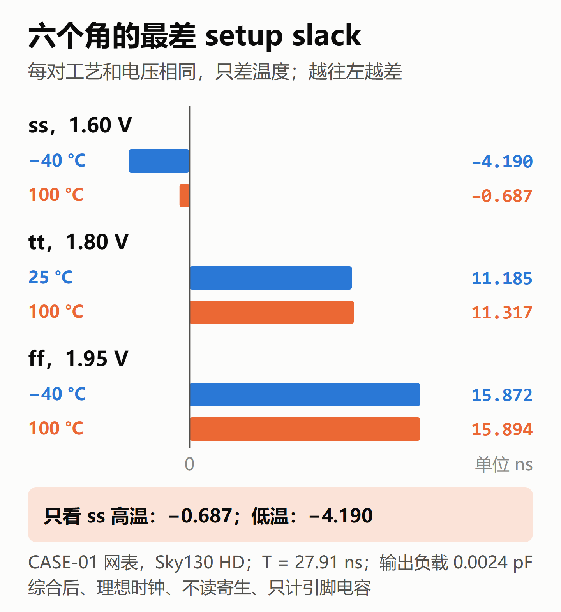
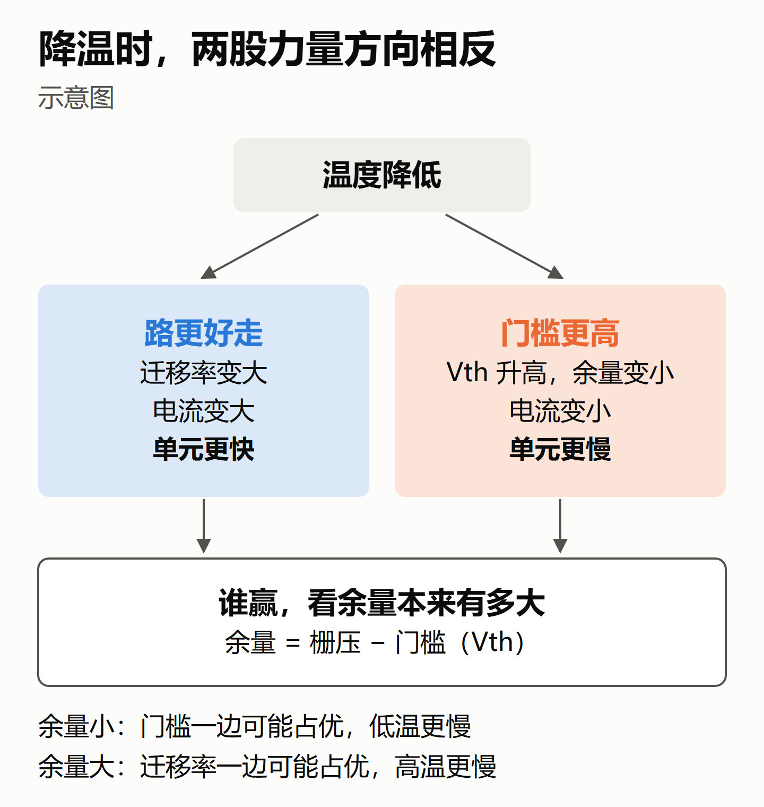
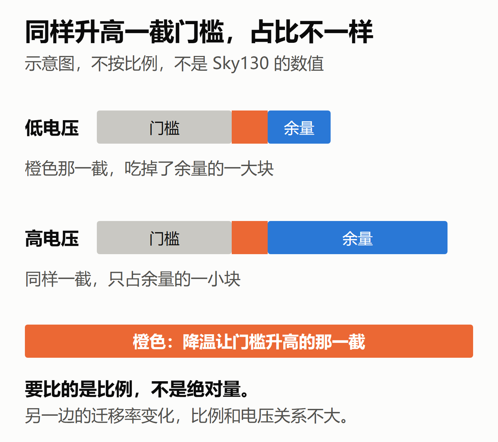
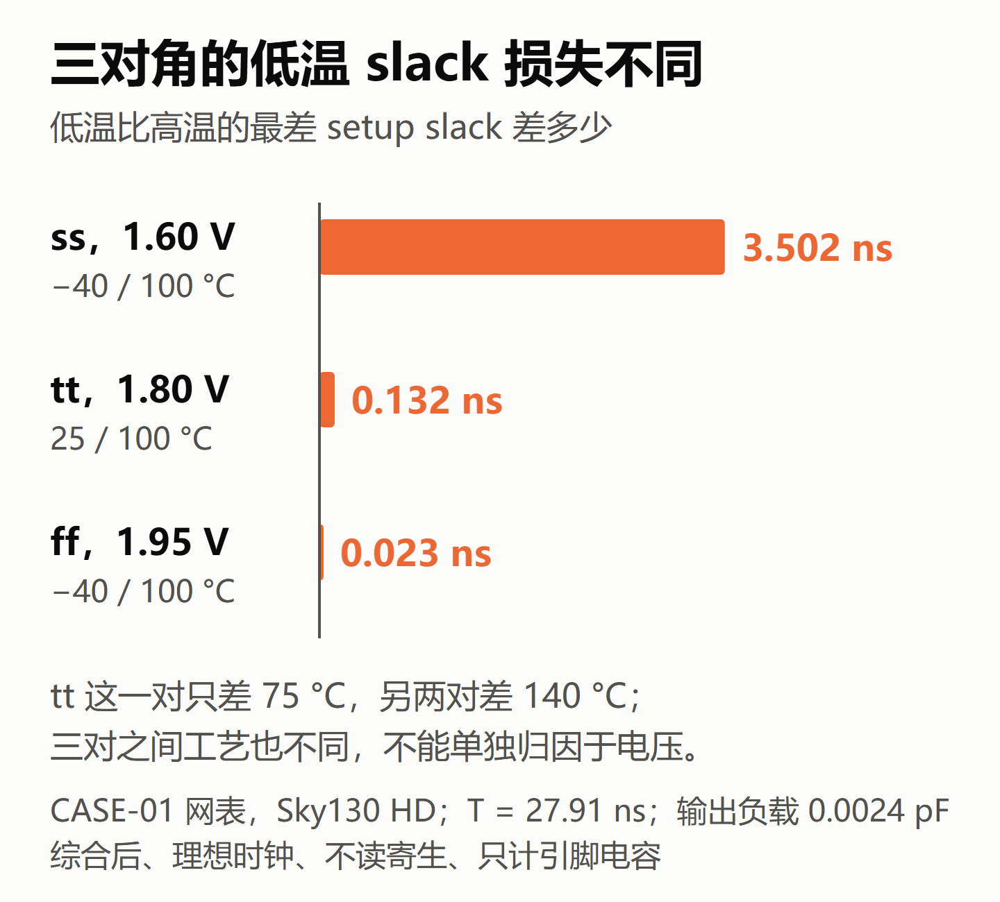
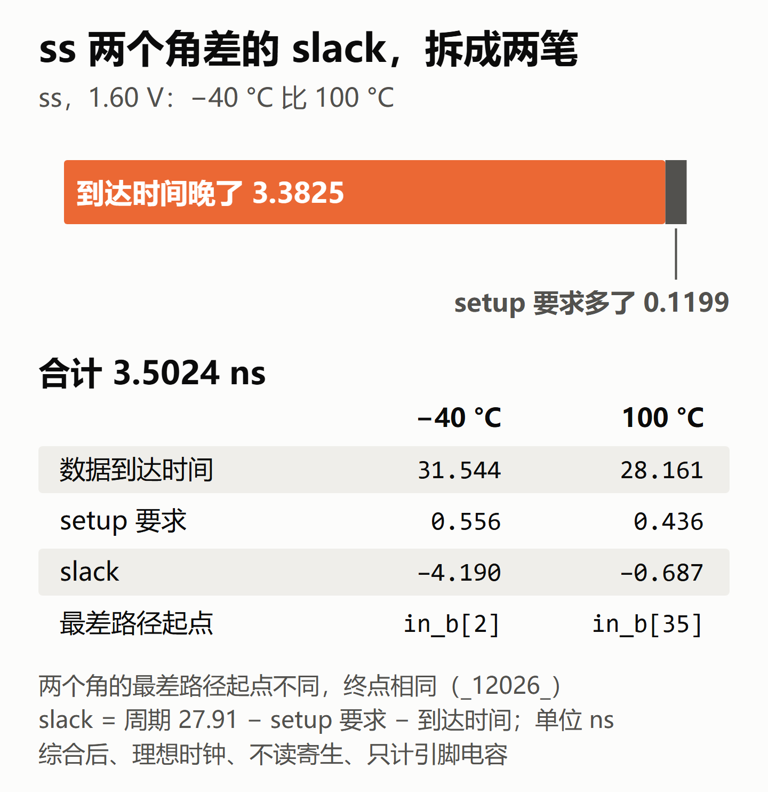
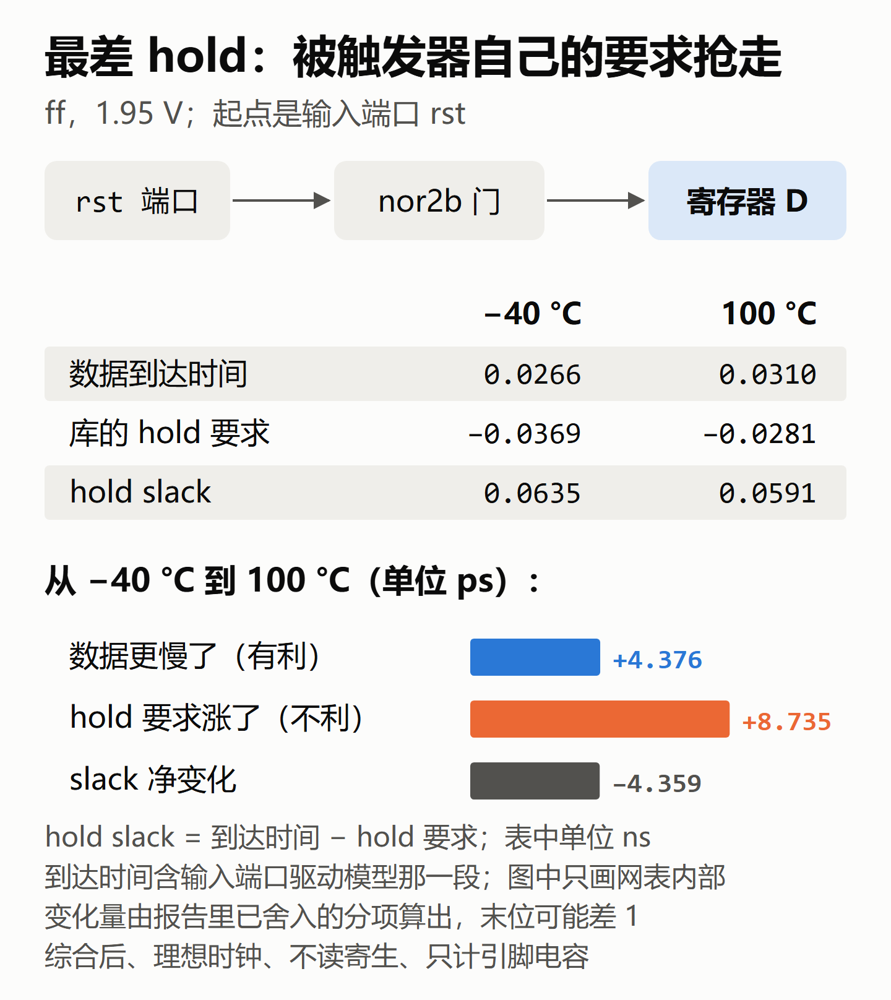
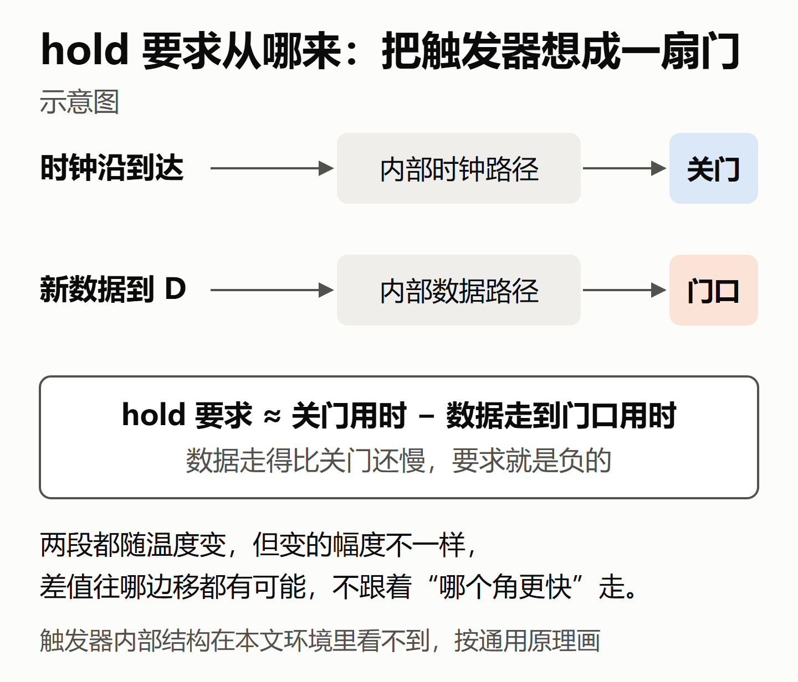

# 芯片冷的时候反而更慢？我用 OpenSTA 亲手跑了一遍温度反转，也问了三个大模型

> STA 学习笔记 · 温度反转
>
> 公众号版。文中的数字都来自 OpenSTA 的原样输出，只在综合后、不带导线寄生的条件下成立，边界见第 7 节。

## 1. 一个反直觉的数字

做时序的人都听过一句老经验：**温度越高，芯片越慢**。所以查 setup 时，大家习惯看"慢工艺、高温"那个角。

可是在我的项目 CASE-01 里，同样是慢工艺（ss）、同样是 1.60 V，两个温度下的最差 setup slack 是这样的：

| 角 | 最差 setup slack |
|---|---|
| ss，1.60 V，100°C | −0.687 ns |
| ss，1.60 V，−40°C | **−4.190 ns** |

先说两个词。setup 检查的是数据能不能及时赶上这一拍的采样；slack 是余量，负数就是迟到了。hold 检查的是新数据会不会来得太早、干扰了这一拍的采样；hold slack 为正就是通过。

零下 40 度反而差了 3.5 ns。这就是常说的**温度反转**。以前我只知道这个名词，说不清为什么。这次我先自己猜，再亲手跑工具对照，最后把同一道题交给三个大模型，看它们怎么解释。

## 2. 我先猜了一遍，大多猜错了

跑工具之前，我先写下了预测：负载会怎么变，transition 会怎么变，tt 和 ff 两对角哪个更差，hold 最差在哪里。跑出来一对，大多数猜错了。

错的原因很简单：心里先有了"高温更慢"的答案，又把原因往负载和 transition 上找。工具给出的结果是：

- **至少在我查的那个节点上，负载解释不了。** 这个环境没有建模导线寄生，路径内部的负载只是单元引脚的电容。两个温度下最差路径都经过的 `_11451_/Y` 这个输出端，高温下负载反而大了约 7.7%，延迟却更小、边沿更快。
- **slew 不是独立的原因。** 在这个节点，低温下的 transition 更缓；但 slew 是单元驱动和负载共同作用的结果，又会继续影响下一级，不是每个节点都一样（到终点 D 端，反而是高温更缓）。
- **tt 和 ff 两对角，也都是低温的 setup 更差。**

下面用通用的晶体管原理来解释这个现象。晶体管内部的参数，本文没有直接验证。

## 3. 为什么冷了反而慢：两股力量在拉扯

晶体管能导多少电流，主要看两样东西：

- **路好不好走**（迁移率）：温度越低，电子越好走，电流越大，单元越快。
- **门槛有多高**（阈值电压 Vth）：温度越低，门槛越高，栅压超过门槛的那段"余量"就越小，电流越小，单元越慢。

降温时，这两股力量方向相反。哪股赢，要看**余量本来有多大**。

打个比方：水压很低的时候，水龙头开口稍微收一点，水就几乎流不出来；水压很高的时候，收一点几乎感觉不到。门槛高出的那一截，在余量小的时候占比很大，在余量大的时候占比很小。

再看我们的数据，"低温比高温差多少 slack"：

| 一对角 | 电压 | 低温比高温差 |
|---|---|---|
| ss | 1.60 V | 3.502 ns |
| tt | 1.80 V | 0.132 ns |
| ff | 1.95 V | 0.023 ns |

这三对数据里，低温带来的 slack 损失依次变小，到 ff 1.95 V 已经快打平了。这和"余量越大，门槛变化的影响越弱"的直觉对得上。按这个道理，余量足够大时，迁移率那一边可能赢回来，又变成"高温更慢"，老经验大概就是这么来的。但这一点我们没有测到。

这里要说清楚边界：三对角之间，变的不只是电压。工艺角不同（ss、ff 代表慢、快两类工艺，通常的解释之一是门槛高低不同，本文没有核实这个 PDK 的数值），tt 那一对的温差只有 75°C，另外两对是 140°C，最差路径也可能换了。所以这张表只能说明三对的结果和上面的直觉**相容**，不能单独归因于电压，也没有测出"翻回高温更慢"的那个交叉点。

ss 那 3.5 ns 还可以再拆一下：数据到达时间晚了 3.3825 ns，触发器自己的 setup 要求也从 0.436 涨到 0.556 ns，多吃掉 0.1199 ns，两项加起来是 3.5024 ns。要注意，两个温度下最差的那条路径不是同一条：起点一个是 `in_b[2]`，一个是 `in_b[35]`，终点相同。

## 4. hold 那一头：被触发器自己的要求抢走了

最差的 hold 出现在 ff、100°C。按"高温下数据跑得更快"去理解，好像说得通。工具告诉我，不是这样。

最差的 hold 路径很短：从输入端口 `rst`（同步复位）出发，网表里只过一个门，就到了寄存器。到达时间里还包含约束给输入端口设的驱动单元模型那一段。注意这里的"最差"是指余量最小，6 个角的 hold 都是通过的。

| ff，1.95 V | 数据到达时间 | 库里的 hold 要求 | hold slack |
|---|---|---|---|
| −40°C | 0.0266 ns | −0.0369 ns | 0.0635 ns |
| 100°C | 0.0310 ns | −0.0281 ns | 0.0591 ns |

100°C 下数据其实**更慢**了约 4.4 ps，本该对 hold 有利。真正抢走 slack 的，是触发器自己的 hold 要求涨了约 8.7 ps。

hold 要求为什么会变？可以把触发器想成一扇门。时钟沿一到，就"下令关门"，但命令要过几级内部电路，门才真正关上。新数据从 D 端进来，也要走几级才到门口。hold 要求大致等于"关门要多久"减去"数据走到门口要多久"，所以它可以是负的：在这个库、这个翻转方向和边沿条件下，新数据比时钟沿早一点点变，也挤不进门，照样满足 hold 检查（这和 setup 是两回事）。两段都随温度变，但变的幅度不一样，所以差值往哪边移都有可能，它不跟着"哪个角更快"走。

还有一个细节：6 个角的最差 hold 都是这同一条路径（起点 `rst`），它在 ss、tt、ff 三对角里，都是高温更慢，并没有反转。长的 setup 路径反转了，短的 hold 路径没有。可见**同一个设计里，不同路径对温度的反应可能不一样**。

## 5. 三个大模型怎么答

我把同一道题，分别贴进 Claude Opus 5.5（Claude.ai 网页版）、Kimi 网页版、DeepSeek 网页版。题目给了观察结果（包括"hold 最差在 ff_100C"），但没给具体路径。下面只说我记下的回答片段，每家只答了一次，不排名。

| | 讲机理 | hold 的理由 | 预测 | 值得注意的地方 |
|---|---|---|---|---|
| Claude Opus 5.5 | 迁移率和门槛两股力量 | "高温下数据路径更快"，这对本次最差 hold 路径不适用；它也指出要同时看 hold 要求，并给了分项核对的思路 | 两项 setup 关系与报告一致；hold 关系是题目给的 | 题目没给路径，它按一般规律答 |
| DeepSeek | 同上 | hold 要求随温度变大，方向与 ff 这对报告一致 | 同上 | 说"在你读入的 liberty 中，−40°C 下的 Vt 高出一截"。它没读过本次用的库，却把通用推理写成了对这份库的核实结论 |
| Kimi | 同上 | hold 要求随温度变大，方向与本路径报告一致；它的公式里有 clk→Q，套不到这条从输入端口出发的路径 | 同上 | 网页版自己下载了 liberty，用工具做了分析（库的版本未核对） |

三家讲机理都讲得很顺。落到"这一条具体路径"上，不同的解释要逐项对照报告才知道站不站得住。我得到的教训有三条：

- **判断 AI 的话，要拿它去对照具体报告。** 讲得顺，不等于对。
- **先问它手上有什么材料。** 没给它的东西，它答不出来，不能算它的错。
- **最要警惕"像是核对过"的话。** 把一般推理说成"在你的文件里看到了"，比算错一个数更容易骗过人。

## 6. 对做项目意味着什么

- **只跑 ss 高温查 setup，会低估一大截。** 在这个设计的当前网表上，高温是 −0.687 ns，低温是 −4.190 ns，只看高温会把违例低估约 3.5 ns。改了电路以后，路径和温度响应都可能变，要重新查各个角。
- **按规定的角分别查 setup 和 hold，不凭"高温更慢"的经验删角。** 实际项目里，先看代工厂、库和项目规定的 PVT 和 RC 角清单。要精简分析角，得有覆盖相关路径和检查类型的依据；光知道"某个电压下不反转"还不够。
- **到了后端，结论可能又不一样。** 本文的结果都来自综合后的网表，没有建模导线寄生。做完布局布线，如果后端分析用的是对应温度下的 RC 参数（或做了温度缩放），有两件事会变：金属导线的电阻随温度升高而变大，会把导线占比大的路径往"高温更慢"那边拉；时钟树有了真实的延迟，launch 和 capture 两边随温度变得不一致时，skew 也会跟着变。所以哪个角最差，到后端要重新看，不能拿综合后的结论直接套。

## 7. 条件和边界

本文的结论只在下面这些条件下成立：

- **设计**：CASE-01 的综合后网表（四对 16 位有符号数相乘再相加，饱和到 32 位输出），只有一个设计。
- **库和角**：Sky130 `sky130_fd_sc_hd`，6 个 PVT 点（tt 1.80 V、ss 1.60 V、ff 1.95 V，各取两个温度）。
- **分析条件**：OpenSTA，综合之后、布局之前；理想时钟，没有时钟树；**不读导线 RC 寄生参数**，负载只有单元引脚电容和输出端口负载（0.0024 pF）。
- **约束**：周期固定 27.91 ns；输入、输出的 max delay 为 5.582 ns，min delay 为 0；输入端口由 `buf_2` 模型驱动，它的输入 transition 为 0；时钟的 transition、latency、uncertainty 都为 0。`rst` 是正常参与时序检查的同步复位输入。setup、hold 要求是库在当前翻转方向和 slew 下查表得到的，本文没有把"温度本身"和"slew 变化"的贡献分开。约束文件在仓库的 `tasks/CASE-01/sdc/case01_sdc.tcl`。
- **不包括后端**：布局布线后的网表和 RC 参数会改变路径延迟，也可能改变哪个角最差。本文没有做后端，这部分没有验证过。
- **观察范围**：每个角只看了最差的一条 setup 路径和一条 hold 路径；setup 的最差路径在不同角上不一定是同一条。六个角是项目自己定的分组，温区中间的点没有查。这是一个设计上的一次观察，不能推广成 Sky130 整个库的规律，也不能推广到别的工艺。
- **机理部分**：晶体管内部的变化（Vth 随温度怎么变、触发器内部结构）在这个环境里看不到，是按通用原理讲的，没有亲手验证。
- **三个模型**：用的是网页版，条件不一样。Kimi 用了工具，另外两家就我所知没有。每家只答了一次，文中只评价我记下的回答片段。这是一次学习练习，不是评测。

CASE-01 的 RTL、约束和综合脚本，以及本文的 OpenSTA 原样输出和出图脚本，都在项目仓库里：https://github.com/hyljjy/ai-silicon-lab
