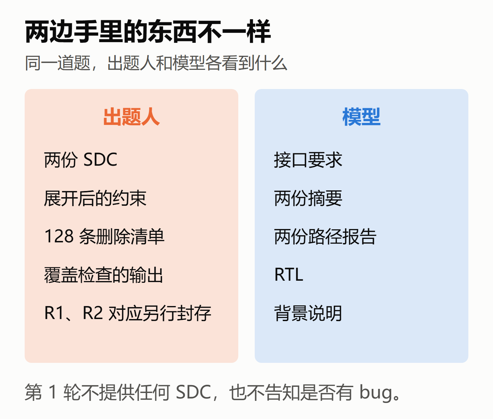
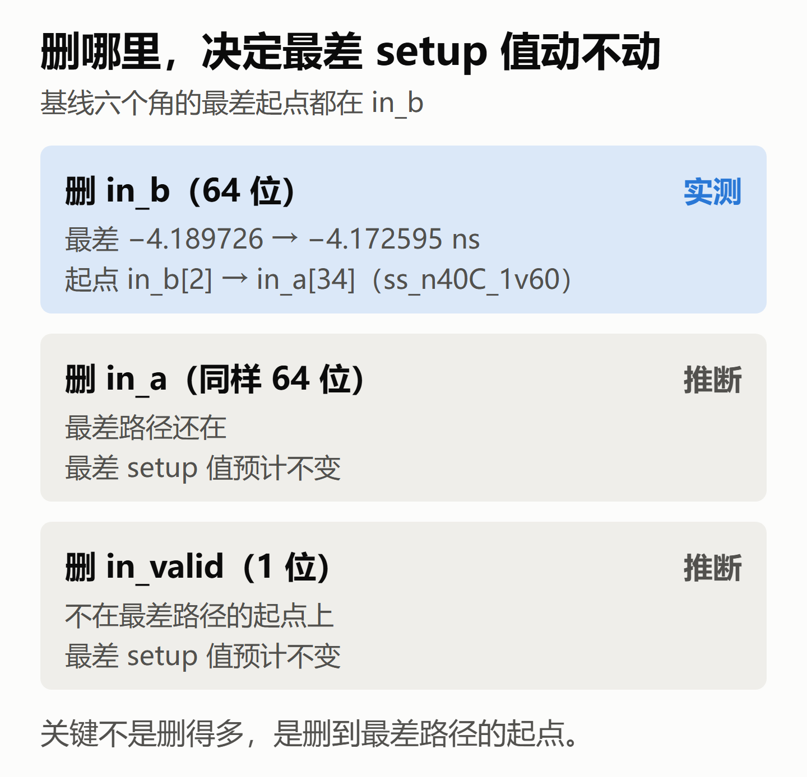
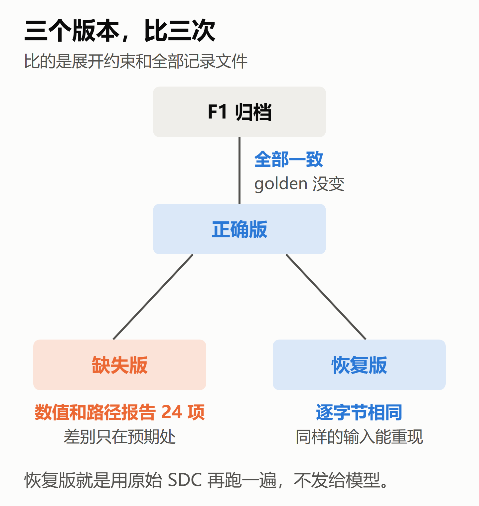
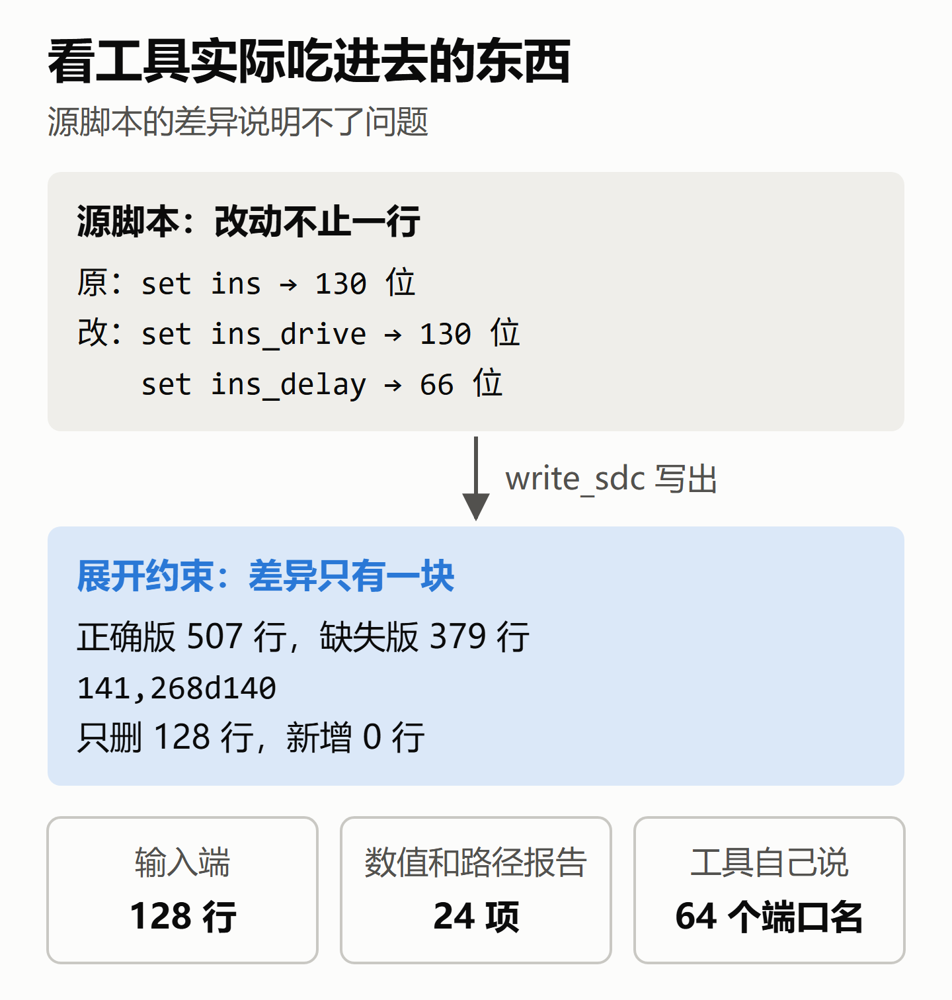
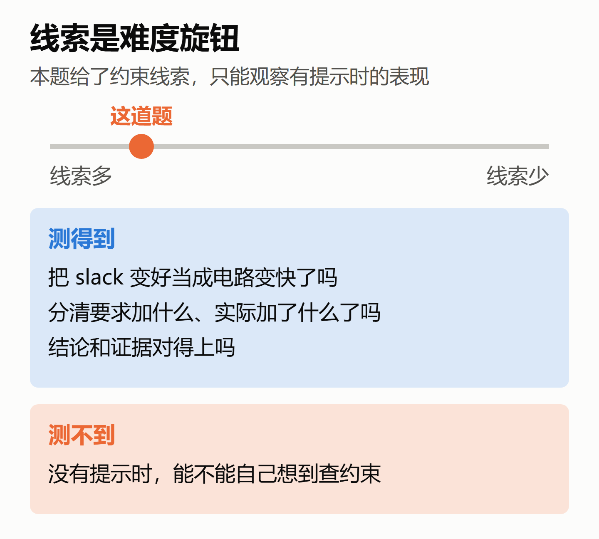

# 给 AI 出时序题：怎样证明埋进去的恰好是这一个 bug

> 测 AI 的方法 · 造题（回顾短文 1/7，例子是 CASE-02）
>
> 公众号版。文中的数字都能在项目仓库的文件里对上，逐项出处见文末链接。本文由项目里负责跑实验的 Claude 按我的讲述整理（和被测的 Claude 是同一个模型），我修改定稿。
>
> 本文所有 slack 都出自同一个分析模型：综合后网表、理想时钟、不读寄生、只计引脚电容。

## 1. 为什么回头写这个

前三篇实验文章写的是 AI 考得怎么样。这组短文换个角度，把"怎么测 AI"一样一样拆开讲：怎么出题，怎么判对错，怎么打分，怎么防偏差。

这些方案主要由 Claude 起草，经过 Codex 外审和多轮修改，我负责确认和裁定。确认不等于讲得清楚，所以我回头把材料读了一遍，用自己的话讲，讲错了再改。这是第一篇，讲造题。

给 AI 出题，和给设计做 bug 注入很像：先埋一个 bug，再看对方能不能查出来。难的不是埋，而是事后要说得清楚三件事：埋进去的恰好是这一个；报告的变化都来自它；这道题到底测了什么。

## 2. 这道题是什么

同一张综合后的网表，跑两次静态时序分析（STA）。其中一次删掉 `in_b[63:0]` 这 64 个输入的 `set_input_delay`，min 和 max 各一条，一共 128 条。这条约束告诉 STA：外部信号相对哪个时钟沿、什么时候到端口。在这次的 OpenSTA 设置下，删掉以后，从这些端口出发的路径还在，但不再参与受约束的 setup/hold 检查和 slack 统计。

结果报告"变好"了：六个角（工艺、电压、温度的组合）的最差 setup slack（时序裕量）都大了一点，大了 0.0040 到 0.0171 ns。最差的角上，−4.189726 ns 变成 −4.172595 ns，最差路径的起点从 `in_b[2]` 换成 `in_a[34]`（ss_n40C_1v60）。电路一点没变，只是少查了 64 个端口。

出题人和模型手里的东西不一样。模型拿到的是接口要求、两次运行的摘要和路径报告、RTL 和一份背景说明，没有任何时序约束脚本（SDC）。接口要求就是告诉它约束应该是什么样。题目只说这是两次分析记录，叫 R1、R2，不说哪里不一样，也不说有 bug。

考试分两轮：第 1 轮读材料、写初判、提查询；执行器把查询跑完，第 2 轮再把结果交给模型复判。

## 3. 先定测什么，再定删哪里

为什么删 `in_b`，不删 `in_valid`？

我第一次的回答是："`in_valid` 的终点还有别的路径可到，不好区分。"这个理由不成立，因为 `in_b` 也一样：这 64 个端口到达的寄存器，别的受约束输入也能到，所以 `check_setup -unconstrained_endpoints` 什么也没报。

真正的区别有两个。

第一是一组和一位。`in_b` 是功能一致的一组输入，边界清楚，能考模型有没有把整组说全。这是规程写的主理由。

第二是最差 setup 值动不动。基线六个角的最差起点都在 `in_b`，删掉以后最差值才会动。这不是因为删得多，而是删到了最差路径的起点。

图里后两行是我的推断，没有运行过；规程里对这一点也只是披露事实，不算成败条件。

所以删哪里取决于想测什么。想测"指标变好了会不会上当"，就要删到决定最差值的地方，否则这个考点不存在。想测"最差值没变时，会不会主动查覆盖"，可以删不影响最差值的端口，并控制其他线索。这是另一种出题方向，本次没有运行，也没有比较难度。

## 4. 三个版本，比三次

出题时跑了三个版本：正确版、缺失版、恢复版。

F1 是 CASE-01 校准后冻结的基线运行，相当于 golden 回归。

恢复版这个名字容易误解，我自己就理解错过，以为是把删掉的内容补回缺失版。其实它就是用没动过的原始 SDC，在新进程里再跑一遍，把正确版重跑一次。它验证的是：独立的新进程读同一份 SDC，能重建出和正确版一致的结果。光靠它不能排除所有外部影响，还要加上环境指纹、输入文件哈希和展开约束这些检查，才能把这次的差异归到那 128 条约束上。它是出题人的自检，不发给模型。

## 5. "恰好"怎么证明

缺失版的源文件改了不止一行。原脚本用同一个变量既加 delay 又加驱动单元，要删 delay 就得把变量拆开，所以看源文件的 diff 说明不了问题。

比的是工具读完脚本以后，用 `write_sdc` 写出来的实际生效的约束。这就像判断两版设计差在哪，不比 RTL 文本，比 elaboration 之后的结果。

比对由执行脚本完成，从三个角度互相核对，三项都要通过：

- **输入端**：展开约束只少了预先登记的 128 行，min 和 max 各 64 条，新增 0 行。不该动的也没动，`in_b` 的 64 条 `set_driving_cell` 还在。
- **输出端**：数值记录和路径报告里，变化恰好落在预先允许的 24 项内。`CHECK_SETUP` 的返回值和警告另按各自的规则核验。
- **工具自己说**：`check_setup` 的警告恰好列出 64 个端口名，和目标清单一致。

这里只列和 bug 直接相关的三项，完整的有效性检查还有环境、输入文件哈希、日志和逐端口覆盖等。

注意删除清单和接口要求是两份东西。接口要求写"应该有什么"，清单写"我删了什么"，模型只看得到前者。

## 6. 线索是难度旋钮

材料里故意留了线索：接口要求写了全部输入该加什么；摘要里能看到起点换了；背景说明明写"实际生效的约束清单尚未提供，可以在检查请求里要"。

我一开始以为线索是用来测模型作弊的，不是。它的作用是引导模型往约束上想，把范围限定住。

这样做有代价：我已经给了提示，它能发现，但测不到不给提示时它能不能发现。

所以这道题测的是三件事：有没有把 slack 变好当成电路变快；有没有分清要求加什么和实际加了什么；结论和证据对不对得上。另外也记录它有没有提出能执行的覆盖查询。

评分不只看有没有找全，也不要求第 1 轮就报出完整答案。我一开始把这道题说成"能不能找全缺失的约束"，这也讲偏了。只看两份报告本来就找不全，第 1 轮停在"假设"才是对的；第 2 轮再按实际拿到的证据，分别记局部、名单级、现象级或完整诊断。

## 7. 一个检验

如果某家第 1 轮就写"确认 R1 缺了 `in_b` 全部 64 位的 min 和 max"，和答案完全一致，这样好吗？

不好。第 1 轮的材料撑不起这句话，预登记的判定表记的是"原因碰巧正确，证据不足、确定性过强"。这家也可能是见过这道题，但单凭一份答复看不出来，判定只看证据。

类比到工作里：看一份 bug report，不是看工程师猜没猜中 root cause，而是看他写成"已确认"的那些，手里有没有波形撑着。

## 8. 记住三句话

- 先定测什么，再定删哪里、给多少线索。
- 证明 bug 要看工具实际吃进去的东西，还要从输入、输出、工具自己三头证。
- 给了提示，就别声称测出了"无提示发现"的能力。

这只是一个案例，每个模型每轮只跑了一次，所有数值只覆盖六个检查过的角，推不到流片后的芯片上。

下一篇讲 CASE-01 阶段 A：模型说的一句话，怎样判对错。

> 项目仓库：https://github.com/hyljjy/ai-silicon-lab
>
> - 本文的数字出处表：https://github.com/hyljjy/ai-silicon-lab/blob/main/docs/posts/retro/01_making_the_task.md
> - CASE-02 实验笔记和全部记录：https://github.com/hyljjy/ai-silicon-lab/tree/main/tasks/CASE-02
