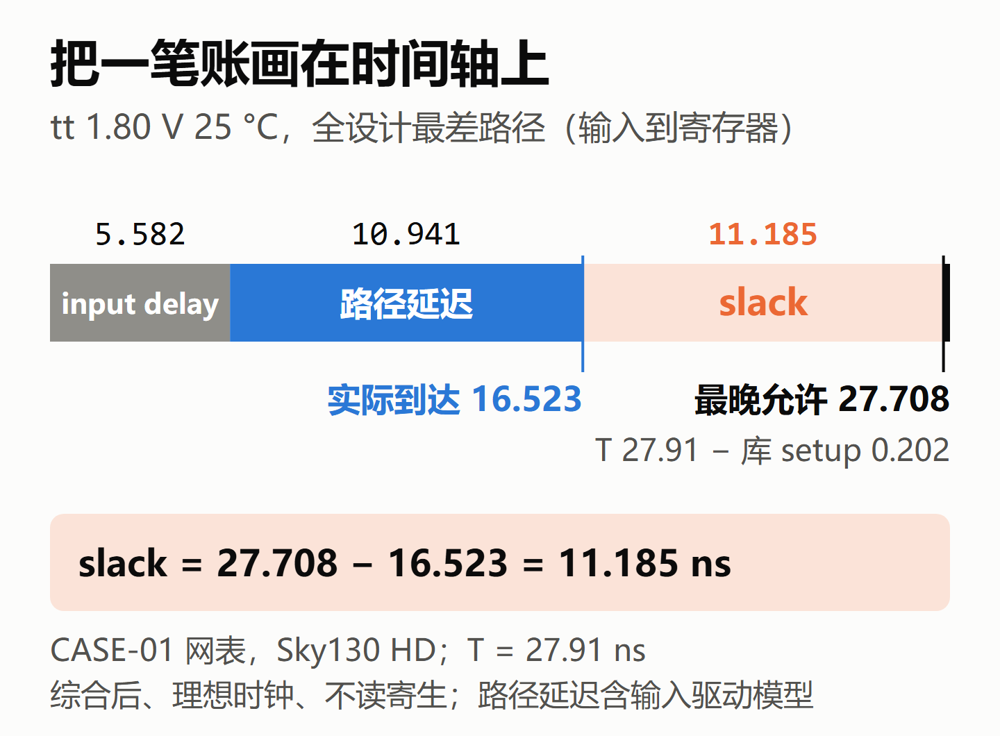
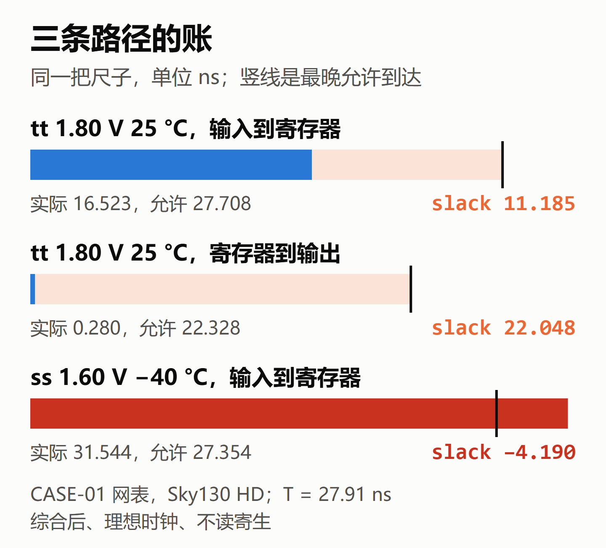
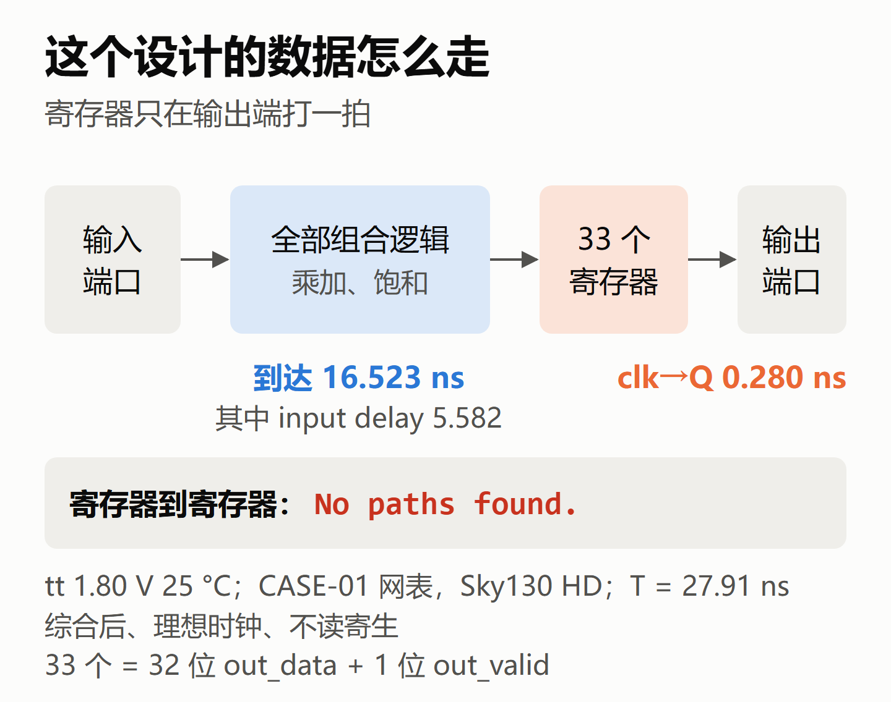
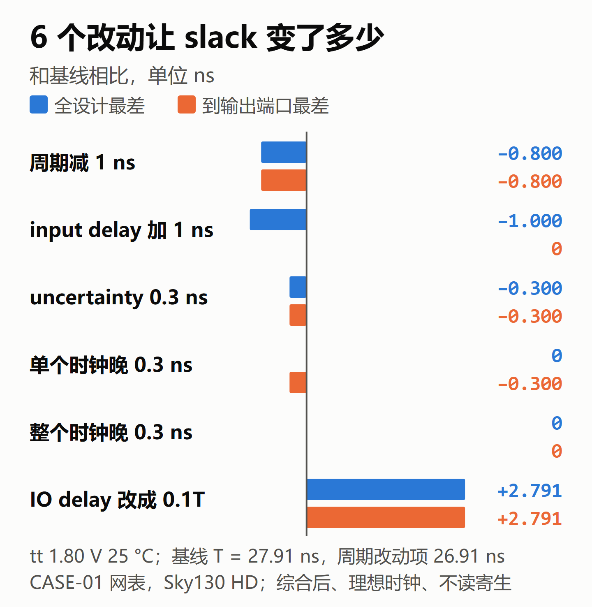
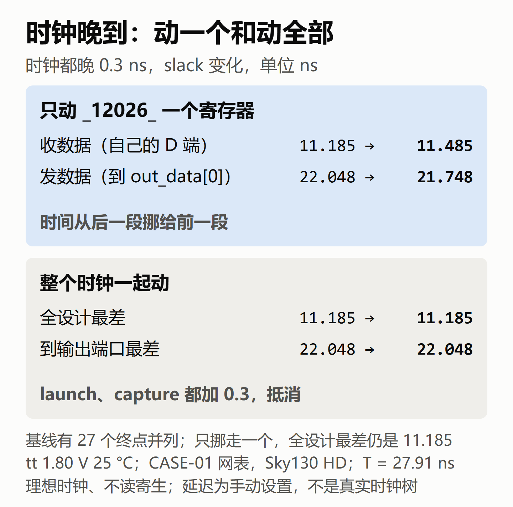
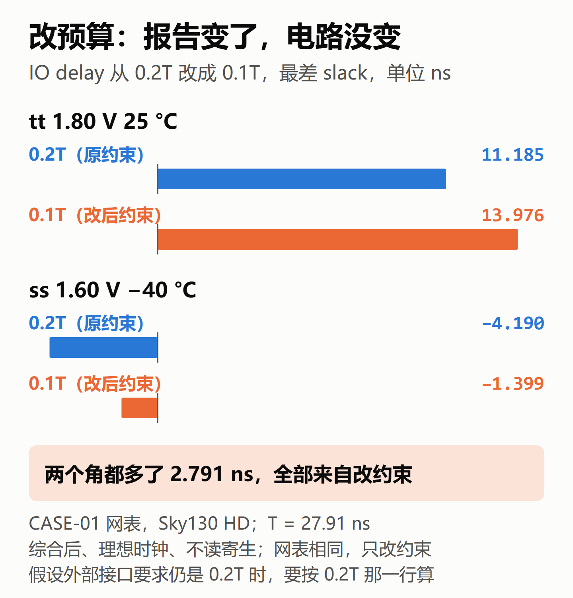
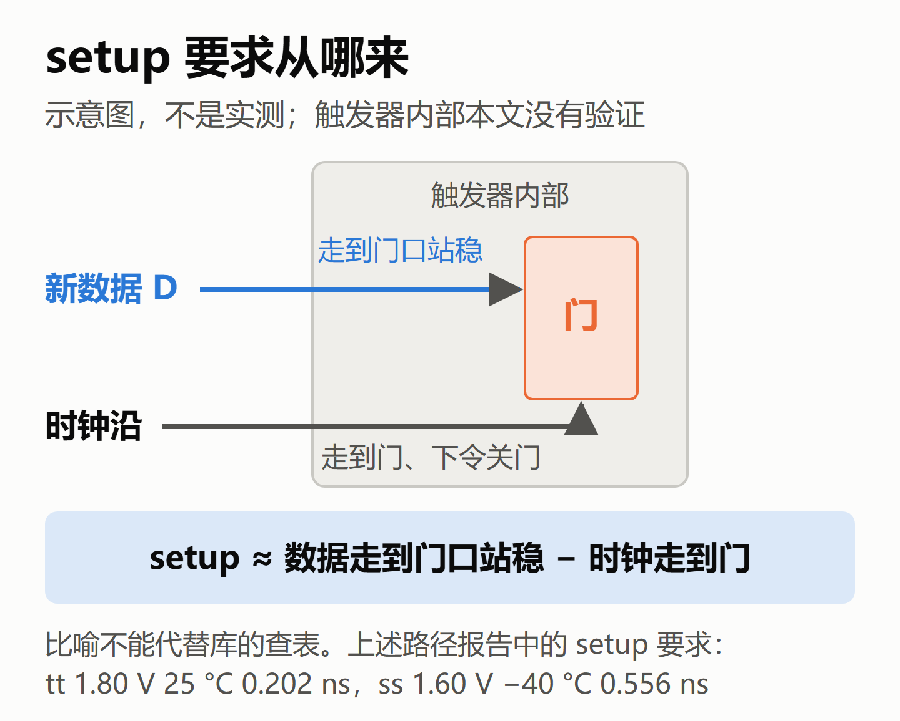

# setup slack 到底是怎么算出来的？我在 OpenSTA 里改了 6 个条件，一笔一笔对账

> STA 学习笔记 · setup slack 的时间账
>
> 公众号版。文中的数字都来自 OpenSTA 的原样输出，只在综合后、理想时钟、不带导线寄生的条件下成立，边界见第 7 节。

## 1. slack 不是"快慢"

做时序的人天天看 slack，但它常被说成"这条路径有多快"。这个说法不准确。

slack 是一笔账：**最晚允许到达的时间，减去实际到达的时间**。正的是还有余量，负的是迟到了。

就像赶火车：发车时间减去你到站的时间，就是你的余量。余量变小，可能是你路上慢了，也可能是火车提前开了。只看余量，分不出是哪一种。

我用自己的 CASE-01 网表做了一次练习：先写下预测，再改条件、跑工具对照，结果大多猜错了。这篇把这本账写清楚。

## 2. 这本账长什么样

下面这本账只针对本文这种情况：同一个时钟、相邻两个上升沿的单周期 setup 检查。发出数据的沿叫 launch，算 0 时刻；收数据的沿叫 capture，在 T 时刻。

> 最晚允许到达 = 周期 T + capture 时钟延迟 − uncertainty − 终点那一项
>
> 实际到达 = launch 时钟延迟 + 起点那一项 + 路径延迟
>
> slack = 最晚允许到达 − 实际到达

时钟延迟是时钟比自己那个沿晚到多少，不包含 T。本文的 CRPR 为 0，也不涉及多周期或其他边沿关系。路径延迟不重复算单列出来的 input delay 或 clk→Q。

"那一项"按路径两头是什么来取，在本文的路径上只取一个：

| | 是寄存器 | 是端口 |
|---|---|---|
| 终点那一项 | 库的 setup 要求 | output delay |
| 起点那一项 | clk→Q | input delay |

clk→Q 是时钟沿到寄存器 Q 输出变化的延迟，output delay 是给模块外部接收一侧预留的时间。

代入三条真实路径（周期 27.91 ns，理想时钟，时钟延迟和 uncertainty 都是 0，单位 ns）。输入路径的路径延迟包含输入端口驱动模型那一段：

| 路径 | 最晚允许到达 | 实际到达 | slack |
|---|---|---|---|
| tt 25°C，输入到寄存器 | 27.708 | 16.523 | 11.185 |
| tt 25°C，寄存器到输出 | 22.328 | 0.280 | 22.048 |
| ss −40°C，输入到寄存器 | 27.354 | 31.544 | −4.190 |

第三条就是负数的样子：允许 27.354 ns 到，实际 31.544 ns 才到，迟到 4.190 ns。

## 3. 先看清这个设计的结构

讲 setup 时，课本上画的大多是"寄存器到寄存器"。可是我让工具查这个设计的寄存器到寄存器路径，返回的是 `No paths found.`。

设计里有 33 个寄存器，就是 32 位 `out_data` 加 1 位 `out_valid`，都只在输出端打一拍。所以输入这一段要走十几 ns，输出这一段只有一个 clk→Q，0.280 ns。

这个例子提醒我：**先看路径的两头是什么，再套公式。**

## 4. 改 6 个条件，看账怎么变

下面都在 tt、25°C 这个角上，每次只改一个条件，都从基线出发。Required 是最晚允许到达，Actual 是实际到达，单位都是 ns。

全设计最差（都是输入到寄存器）：

| 改动 | Required | Actual | slack |
|---|---|---|---|
| 基线 | 27.708 | 16.523 | 11.185 |
| 周期减 1 ns | 26.708 | 16.323 | 10.385 |
| input delay 加 1 ns | 27.708 | 17.523 | 10.185 |
| uncertainty 0.3 ns | 27.408 | 16.523 | 10.885 |
| 单个时钟晚 0.3 ns | 27.708 | 16.523 | 11.185 |
| 整个时钟晚 0.3 ns | 28.008 | 16.823 | 11.185 |
| IO delay 改成 0.1T | 27.708 | 13.732 | 13.976 |

到输出端口最差（都是寄存器到输出）：

| 改动 | Required | Actual | slack |
|---|---|---|---|
| 基线 | 22.328 | 0.280 | 22.048 |
| 周期减 1 ns | 21.528 | 0.280 | 21.248 |
| input delay 加 1 ns | 22.328 | 0.280 | 22.048 |
| uncertainty 0.3 ns | 22.028 | 0.280 | 21.748 |
| 单个时钟晚 0.3 ns | 22.328 | 0.580 | 21.748 |
| 整个时钟晚 0.3 ns | 22.628 | 0.580 | 22.048 |
| IO delay 改成 0.1T | 25.119 | 0.280 | 24.839 |

每一行都能用第 2 节的公式算出来。逐条看：

**周期减 1 ns，slack 只少 0.8。** 这个项目的约束里，input delay 和 output delay 都写成 0.2T。周期少 1 ns，外面的预算也跟着少 0.2 ns。输入这边的 Actual 变小了 0.2，但路径延迟还是 10.941 ns，一点没变快，只是"出发时间"提前了。所以 **Actual 变小，也不等于走得快**。对本文这两类 IO 路径，在其他项固定时，只有 IO delay 是固定的绝对时间，周期减 1 ns，slack 才减 1 ns；这里 IO delay 随 T 缩放，所以只减 0.8 ns。

**input delay 加 1 ns，输出这边不动。** input delay 只记在从输入端口出发的路径上，到输出端口的路径从寄存器出发，账上没有这一项。

**uncertainty 让 slack 变差。** 它不是"时钟晚到"，而是从最晚允许到达里预先扣掉的安全余量：时钟可能有抖动和偏差，先按不利情况算。所以 Actual 不动，Required 少 0.3，两类路径的 slack 都减少 0.3 ns。

**只让一个寄存器的时钟晚 0.3 ns。** 我选的是 `_12026_`。它自己的 slack 从 11.185 变成 11.485，但全设计最差一点没动。原因是 6 位小数下有 27 个终点并列 11.185458，挪走一个，剩下的还在，报告里的最差只是换成了 `_12027_`。看到一条最差路径，不等于只有一条。

同一个寄存器还是 `out_data[0]` 的起点，它的时钟晚了，输出这边就少 0.3。输入多 0.3，输出少 0.3：**时钟偏移不产生时间，只是把时间从后一段挪给前一段。** 这就是 useful skew 的基本思路。能不能这样挪，还要同时检查相邻路径和 hold，本文只展示这两段 setup 的变化。

**整个时钟晚 0.3 ns，两边都不变。** 这次 launch 和 capture 都加 0.3，正好抵消。在这个环境下，输入路径的报告里也有一行 `clock network delay (ideal)`，值是 0.300，所以输入路径的 launch 也跟着晚了。影响 slack 的是两边时钟的差，不是时钟晚到本身。

## 5. slack 变好，不等于电路变好

最后一个改动值得单独说。input delay 是约束写下的外部到达时间：相对参考时钟，数据到本模块之前，外面要用掉多少。这段时间通常包括上游的 clk→Q、上游逻辑和走线。它是一笔分给外面的预算，不是测出来的。

把 IO delay 从 0.2T 改成 0.1T，全设计最差 slack 从 11.185 涨到 13.976。电路一个门都没变，多出来的 2.791 ns 全是从外面的预算里划过来的。

同样的改动放到 ss、−40°C，报告从 −4.190 变成 −1.399，看上去好了一大截。

如果外部接口要求仍是 0.2T，那么按这个要求、在同一分析模型下算，tt 的 slack 仍是 11.185 ns，ss −40°C 的仍是 −4.190 ns。只把约束填成 0.1T，并没有满足原来的接口要求，违例还在。

预算要改得有依据，比如和上下游对过的接口时序，不能为了报告好看。

## 6. 库的 setup 要求从哪里来

账上还有一项：库的 setup 要求。对上面选出的路径，OpenSTA 查到的值在 tt 下约为 0.202 ns，在 ss −40°C 下约为 0.556 ns。它们取决于单元、PVT、数据翻转方向，以及数据和时钟的边沿快慢，不是整个角的固定常数。

数据为什么不能正好在时钟沿到？

可以把触发器想成一扇门。时钟沿一到，就下令关门；新数据从 D 端进来，要走一小段才到门口，并且要在门关上之前站稳。setup 大致就是"数据走到门口站稳的时间"减去"时钟走到门的时间"。这只是帮助理解内部竞争关系的比喻，实际的 setup 要求来自库的表征和查表，不能用图里的两段路程算出来。

如果来晚了，结果不只是采到旧值。数据要是正好在关门的时刻变化，内部电压可能一时形成不了稳定的 0 或 1，这就是亚稳态：输出可能比平时更晚才稳定，最后落到哪个值说不准。

## 7. 条件和边界

本文的结论只在下面这些条件下成立：

- **设计**：CASE-01 的综合后网表（四对 16 位有符号数相乘再相加，饱和到 32 位输出），只有一个设计。它没有寄存器到寄存器的路径，公式里"起点是寄存器"的情况，只在寄存器到输出端口这段用上了，那段没有组合逻辑。
- **库和角**：Sky130 `sky130_fd_sc_hd`。第 4 节都在 tt、1.80 V、25°C；第 2、5、6 节另外用到 ss、1.60 V、−40°C。
- **分析条件**：OpenSTA，综合之后、布局之前；理想时钟，没有时钟树；不读导线 RC 寄生参数，内部负载只计单元引脚电容。
- **基线约束**：周期 27.91 ns；输入、输出的 max delay 都是 0.2T（5.582 ns）；setup uncertainty、时钟 latency、时钟 transition 都是 0；输入端口由 `buf_2` 模型驱动，它的输入 transition 为 0；输出端口负载 0.0024 pF。约束文件在仓库的 `tasks/CASE-01/sdc/case01_sdc.tcl`。
- **时钟那两行是手动设的。** `set_clock_latency` 只是在账上加 0.3 ns，不是真实时钟树的结果。"整个时钟晚到两边抵消"是这个理想时钟环境下的结果。有了真实时钟树，外部发来的数据不一定跟着内部时钟树一起晚，IO 路径要重新看。这部分没有亲手验证。
- **没有覆盖的账**：只看了 setup，没有看 hold；真实时钟树下的 skew、CRPR、OCV 等，这个环境里都没有。
- **观察范围**：每个条件看的是全设计和到输出端口各自最差的路径，另外查了基线的终点列表和 `_12026_` 自己的路径；27 个终点并列是基线 tt、25°C 下的情况，我没有查它们为什么相同。
- **数字精度**：正文统一保留三位小数，核算以原始输出为准，末位可能有计算和打印舍入的差异。
- **机理部分**：触发器内部和亚稳态是按通用原理讲的，这个环境里看不到，没有亲手验证。

CASE-01 的 RTL、约束和综合脚本，以及本文的 OpenSTA 原样输出和出图脚本，都在项目仓库里：https://github.com/hyljjy/ai-silicon-lab
