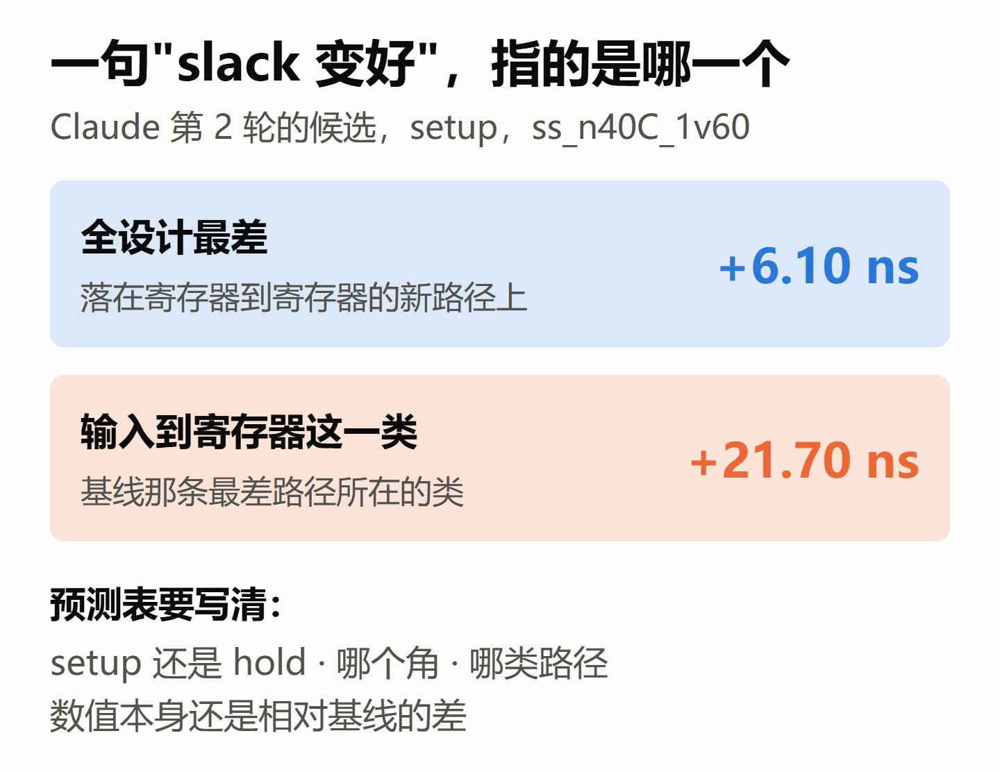
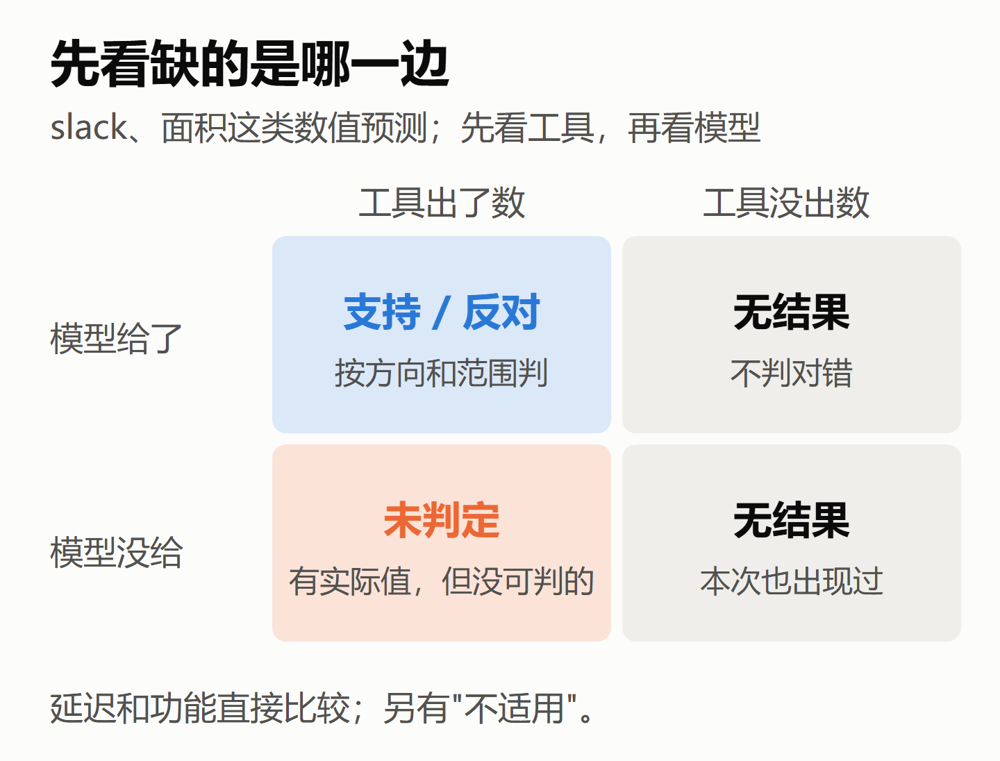
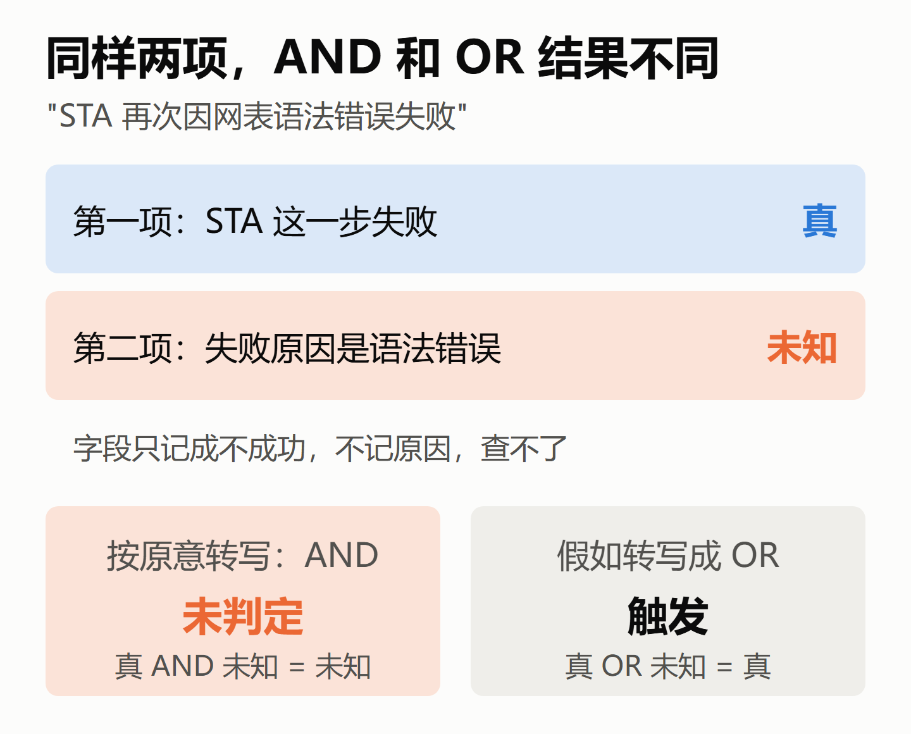
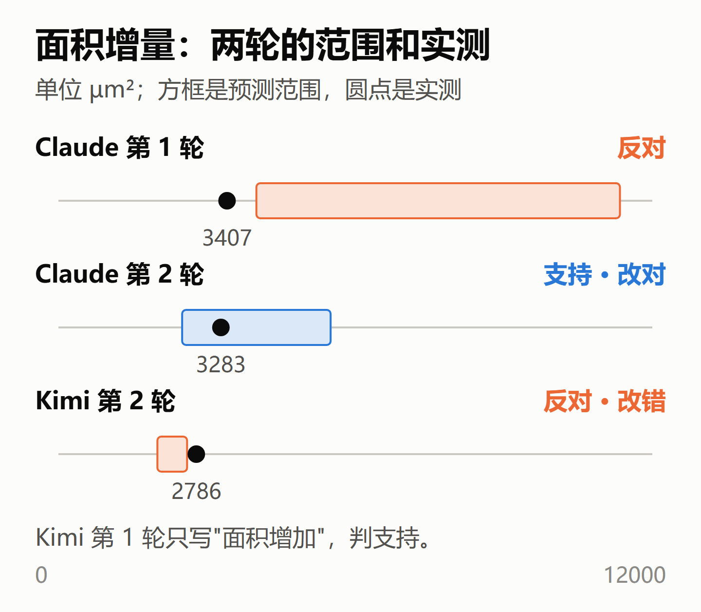
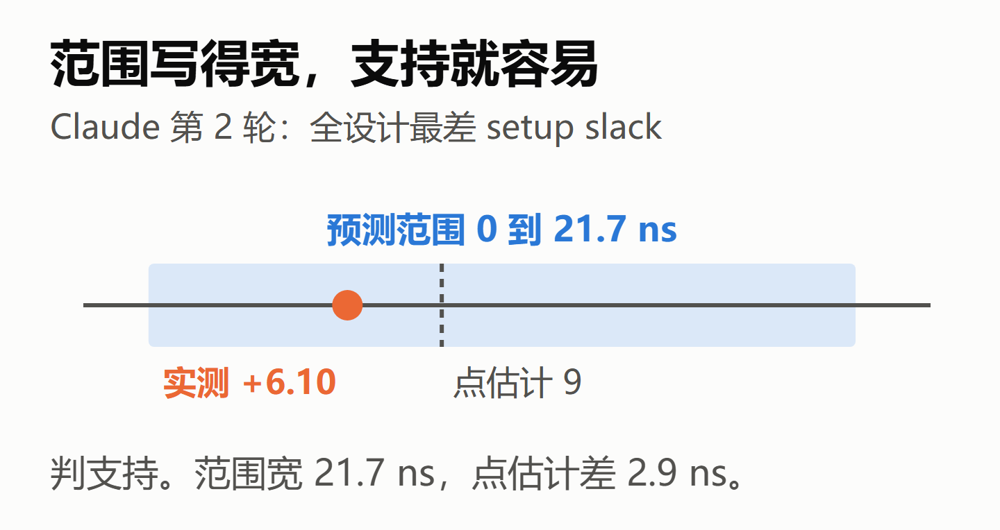

# AI 改 RTL 之前写下的预测，跑完怎么对

> 测 AI 的方法 · 判预测（回顾短文 3/7，例子是 CASE-01 阶段 B）
>
> 文中的数字都能在项目仓库的文件里对上，逐项出处见文末链接。本文由项目里负责跑实验的 Claude 按我的讲述整理（和被测的 Claude 是同一个模型），我修改定稿。
>
> 本文的 slack 都出自同一个分析模型：综合后网表、理想时钟、不读寄生、只计引脚电容。

## 1. 先写预期，再跑

上一篇讲怎么判模型已经说出来的话。这一篇讲另一种话：模型在动手之前写下的预测。

CASE-01 阶段 B 让三个模型动手改 RTL。改之前，模型要先写两样东西：预测改完会怎样，以及出现什么结果就算自己失败了。改完以后跑功能仿真、综合和 STA，再拿结果逐条对。某个模型某一轮交出的那份 RTL 叫候选，修改前固定保存的版本叫基线。

这和 tapeout 前写预期很像：这版改完 slack 大概多少、面积涨多少、什么情况算没改好。写在前面，跑完再对，才知道当初的判断有没有根据。

这些规则主要由 Claude 起草，经过 Codex 外审和修改，我负责确认。这次我回头读材料，用自己的话重讲一遍。

## 2. 先填表：把"哪个 slack"钉死

模型不能只写一句"slack 会变好"，要填一张预测表。主要字段是：

- **看什么**：slack、面积、延迟拍数、功能，四选一；slack 还要写 setup 还是 hold。
- **看哪里**：哪个角，或者六个角里最差的那个；哪类路径，全局、输入到寄存器、寄存器到寄存器、寄存器到输出。
- **怎么算**：候选的数值本身，还是候选减去基线的差。
- **说什么**：方向（改善、退化、不变、未知），范围的上下限，点估计，依据。

点估计就是只给一个数，比如"约 +3 ns"；范围是"+2 到 +5 ns"。这就像估工期："大概 3 周"是点估计，"2 到 5 周"是范围。

一句"slack 会变好"判不了，因为 slack 有很多个：

表就是把"哪一个"钉死。填表还有一个好处：判的时候由脚本比字段，不用人去解读文字。表以外的自由文字，规程不逐条判，只在文章里原文引用，因为把自由文字拆成判断，正是上一篇说的最容易出偏差的地方。

## 3. 判一条预测

规则在正式运行之前就冻结，也就是先定好、存档，结果出来后不回头改。先说 slack 和面积这类连续数值预测：

- **方向**：写了就判。实际变化和预测方向一致算支持，否则算反对。
- **范围**：给了任一端就判。落在范围内算支持，没写的那一端当作无界。
- **汇总**：能判的部分全部支持，这条才算支持；有一处反对，就是反对。
- **点估计**：只列出来，不判。

延迟拍数和功能另判：模型写的拍数、pass 或 fail 和实际值直接比较，相同算支持，不同算反对。

点估计不判，原因有两层。上一篇判的是报告里已有的数，抄错一位就是错，所以容差按半个末位算。这里判的是运行前的预测，用同样的容差，几乎全是反对，没有信息量。

那放宽一点行不行？也不行。模型没说自己能差多少，判的人不能替它补一个窗口，否则又是判的人在定标准。

判完的标签有五种。要先分清，缺的是哪一边：

顺序是先看工具：所需实际值没有取得，记"无结果"，模型给没给都一样。实际值有了，但模型没给可判的承诺，记"未判定"。预测的对象在候选里不存在，或者按差值预测而基线没有这个对象，另记"不适用"。

两轮一共 20 条"无结果"，全是因为 STA 没出数。这 20 条不判支持或反对，就像 testcase 没跑，既不算 pass 也不算 fail。STA 为什么没有结果，另按评估失败记录说明；本次遇到的是冻结流程的网表兼容性问题。

## 4. 失败条件：写成布尔式，留一个"未知"

失败条件是模型事先写的"出现什么结果就算我失败了"。规程把每条按原文含义转写成布尔式，保留"或""且"这类逻辑关系，并把组合写明，不靠隐含的优先级。每一项取真、假或未知；字段没跑、无效，或这一项根本查不了，就取未知。

- AND：有一项假就是假，全真才是真，其余是未知。
- OR：有一项真就是真，全假才是假，其余是未知。

整体为真判"触发"，为假判"未触发"，为未知判"未判定"。

第 2 轮 Kimi 和 DeepSeek 都写了一条："STA 再次因网表语法错误失败"。它确实发生了，却只能判未判定。这句按原意被转写成"STA 失败 AND 原因是语法错误"：

冻结的字段只记 STA 成不成功，不记失败原因，所以第二项查不了。这是先定规则的代价：事后明明知道发生了什么，也不能临时加一个字段。

## 5. 两轮之间：改对和改错

第 2 轮的每条预测都和第 1 轮对过，对象没变的才比较。第 1 轮反对、第 2 轮支持，记"改对"；反过来，记"改错"。结果是改对 2 条，改错 1 条，全是面积：

Claude 第 1 轮把范围写高了，实测低于下限；第 2 轮往下调，落进范围。增量和绝对面积各算一条，共 2 条改对。

Kimi 第 1 轮只说面积会增加，判支持；第 2 轮给了范围，实测超出上限，判反对，记改错。

要注意，"改错"说的是预测的判定从支持变成了反对，不是说 RTL 改错了。Kimi 第 2 轮给的信息更多，反而记了改错，所以这个数不能读成"模型退步了"。

## 6. 规则防不住的地方

如果一个模型只想把"支持"刷多，最简单的办法是把范围写大。方向和范围都填"未知"不会增加支持，但避开了可判的承诺，记未判定。这两种情况都要另外展示。

这条判支持，但几乎没说出什么，点估计也差了约 2.9 ns。这不说明 Claude 在刷条数：下限 0 可能就是"转正"这个目标，上限可能是它估的天花板。

我在规程里没找到限制范围宽度的规则。它的处理不是防，而是不让条数说话：不排名，支持比例不用于横向比较，范围和点估计原样列出，读的人能自己看宽窄。

如果要防，有几种做法，从轻到重：

1. **多报几列，不改判定。** 每条预测再列出范围有多宽、点估计差多少、填"未知"的有几条。
2. **按指标分别设上限。** slack 按 ns，面积按基线的百分比，不能用一个固定值。上限定多少都有点主观，而且模型可能改填"未知"，变成未判定，同样不扣分，所以第 1 条那几列还得一起报。
3. **按宽度打分，不只判对错。** 落进范围的，范围越窄分越高；没落进的，按差多远扣分。写宽不再白占便宜，写窄而且中，才拿高分。这在预测评估里叫区间评分。要这样打分，得事先约定范围代表多大把握，以及评分公式。
4. **让模型说把握多大**，比如"80% 把握落在这个范围"，再看大量预测里实际落中的比例是否接近 80%，也就是校准。这次没有要求模型报告把握多大，每份也只有 5 到 10 条预测，不足以可靠评估。

下一次如果要改，我会选 1 加 3：判定规则不动，另外报宽度和误差，再加一个区间分。这些都是事后的想法，这次没有做。

## 7. 记住三句话

- 预测要填表，把指标、角、路径类和比较方式钉死，才能机械地判。
- 先看工具有没有出数（无结果），再看模型有没有给可判的东西（未判定），然后才谈对错。
- "支持"只说明没被推翻；范围写得越宽，越容易支持，说明的东西也越少。

这只是一个案例，每个模型每轮只跑了一次，数值只覆盖检查过的六个角，推不到流片后的芯片上。

> 项目仓库：https://github.com/hyljjy/ai-silicon-lab
>
> - 本文的数字出处表：https://github.com/hyljjy/ai-silicon-lab/blob/main/docs/posts/retro/03_judging_predictions.md
> - CASE-01 阶段 B 的规程和判定记录：https://github.com/hyljjy/ai-silicon-lab/tree/main/tasks/CASE-01/revise
